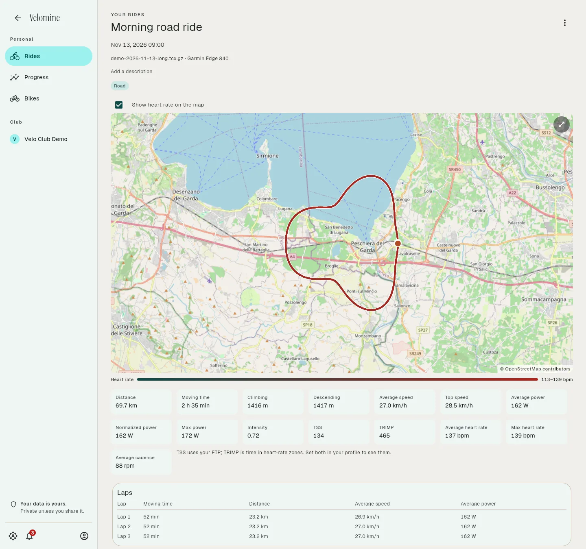
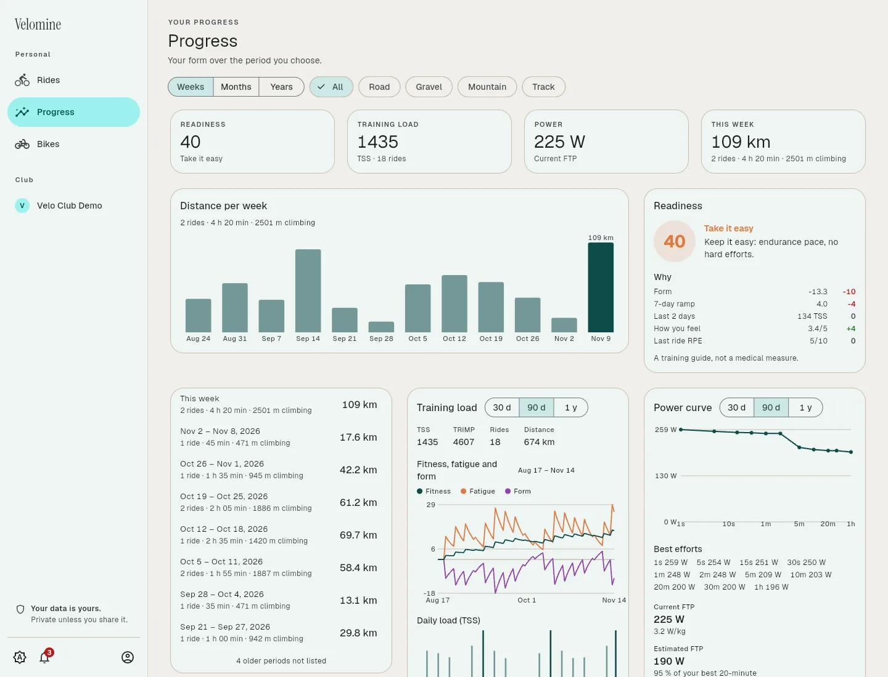
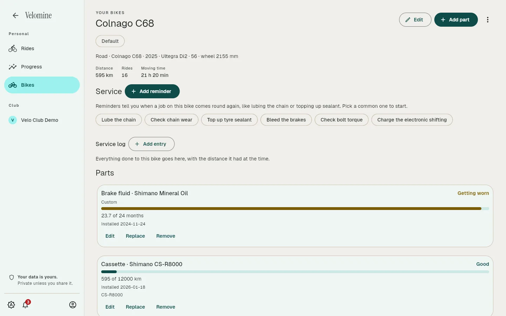

# Velomine

**Cycling training for clubs and riders, where every ride stays yours.**

[Website](https://velomine.eu) · [Try the demo](https://velomine.eu/demo/) · [What works today](https://velomine.eu/status/) · [Self-host it](#self-hosting) · [Give feedback](https://github.com/zenkraker/Velomine/issues/new?template=feedback.yml)



Velomine reads your rides from a bike computer, the Android app or a Strava export, and turns them into the analysis a cyclist and a coach need. Clubs get coaches, a ride calendar and a route library, and each rider decides exactly what their coach may see.

## Why Velomine

- **Your data is yours.** Export everything, every original file included, or delete everything, whenever you want. Nothing is visible to anyone until you share it, and you can see who looked.
- **No pro tier.** Every feature is included for everyone. You pay to have it hosted, or host it yourself for free.
- **No ads, no data sale, no AI training on your rides.** No public feed, no follower graph, no leaderboards by default.
- **Cycling only.** Power, components, climbing and club rides, not a generic fitness app.
- **Open source** under AGPL-3.0. The cloud and a self-hosted server run the same software.

## What it does today

| | |
|---|---|
|  |  |
| **Progress:** weekly and monthly totals, training load, fitness and fatigue, the power curve and FTP, and a daily readiness score. | **Bikes and parts:** every component with its wear, service reminders and a service log. |

- **Rides:** FIT, GPX and TCX files, whole folders at once, or your full Strava export; map, charts, laps, heart-rate and power zones.
- **Clubs and coaches:** join with a code, a coach sees only what each rider shares, planned club rides with a meeting point and a route, and a shared route library.
- **Android app** that records with the screen off and connects to a heart-rate sensor.
- **Wellbeing check-in** and readiness, as health data with explicit consent.
- **Accounts:** optional two-factor sign-in, single sign-on, a list of signed-in devices; English and Italian.

It is early: the interface is rough in places, and there are bugs. The iOS recorder, power and speed sensors and automatic sync from Garmin or Wahoo are not built yet. The [status page](https://velomine.eu/status/) keeps the full list.

## Self-hosting

Self-hosting is free for riders and clubs, with every feature and no member limit. Everything runs with Docker: the server, the web app and PostgreSQL. An optional [supporter licence](https://velomine.eu/pricing/#supporter) funds the project and unlocks nothing.

### Try it on your computer

This starts the whole stack with one command: the server, the web app and PostgreSQL, built from source. You do not need .NET, Flutter or PostgreSQL installed.

#### What to install

| Install | Why | Notes |
|---------|-----|-------|
| **Docker** with Compose 2.24 or newer | Builds and runs everything | Windows and macOS: [Docker Desktop](https://www.docker.com/products/docker-desktop/) (on Windows with the WSL 2 backend). Linux: Docker Engine plus the Compose plugin. The command must work as `docker compose` (with a space), not the old `docker-compose`. |
| **Git** | To get the code | Any recent version. |
| **Chrome, Edge or Firefox** | To open the web app | Safari is untested. |

#### Start it

```
git clone https://github.com/zenkraker/Velomine.git
cd Velomine
docker compose up --build
```

The first run takes roughly 5 to 10 minutes (later starts take seconds). It is ready when the log shows `Now listening on: http://0.0.0.0:8080`. Then open **http://localhost:8080** — the presentation site. Press *Sign in* to open the web app, and sign in as `admin@velomine.local` with the password `Velomine-dev-1`.

Stop it with Ctrl+C. `docker compose down` removes the containers and keeps your data; `docker compose down -v` also deletes the data (database, uploaded files and keys), for a fresh start.

**Trying single sign-on.** `compose.development.yaml` adds Dex, a small test sign-in provider:

```
docker compose -f docker-compose.yml -f compose.development.yaml up --build
```

Sign in with *Dex (local test)* as `rider@sso.test` / `password`. It also needs port 5556, and Chrome, Edge or Firefox, which send `dex.localhost` to your own machine. Dex is for trying it out only; never run it on a shared server.

### Run it on a server

A server runs the same `docker-compose.yml`, from the images CI publishes instead of a build, behind HTTPS.

1. Clone the repository on the server, or copy `docker-compose.yml` there (plus `compose.demo.yaml` and `deploy/traefik/routes.yaml`, if you want Traefik).
2. Copy `.env.example` to `.env` next to them and set at least `VELOMINE_VERSION`, `POSTGRES_PASSWORD`, `VELOMINE__PUBLICURL` and the first admin. See [Settings you can change](#settings-you-can-change).
3. Put HTTPS in front. Either:
   - **Traefik from `compose.demo.yaml`**, which gets Let's Encrypt certificates itself: point the domain's DNS at the server, open ports 80 and 443, and set `COMPOSE_FILE=docker-compose.yml:compose.demo.yaml`, `VELOMINE_DOMAIN` and `VELOMINE_ACME_EMAIL` in `.env`. The public demo runs exactly this.
   - **Your own reverse proxy**, forwarding to the web container's port (`VELOMINE_PORT`, default 8080). Do not expose that port to the internet directly: it is plain HTTP.
4. Start it: `docker compose pull && docker compose up -d --wait`. To upgrade or roll back, change `VELOMINE_VERSION` and run the same command. `--wait` fails unless the server and the web app answer.

### Backups and upgrades

Back up the database (`docker compose exec postgres pg_dump -Fc -U velomine velomine > velomine.dump`) and the `velomine-files` and `velomine-keys` volumes, together. Without the keys, every member is signed out and old links stop working.

To upgrade, set the new `VELOMINE_VERSION` in `.env` and run `docker compose pull && docker compose up -d --wait`. Database changes are applied on start and stay compatible with the previous release, so going back one version is safe. The [Releases](https://github.com/zenkraker/Velomine/releases) page lists every version.

### What your server talks to

Nothing is sent to the Velomine project by default.

| What | Default | Setting |
|------|---------|---------|
| Map tiles, loaded by each member's browser or phone | OpenStreetMap | `VELOMINE__MAP__TILEURL` |
| Error reports, traces and logs | Off | `VELOMINE__TELEMETRY__*` and the standard `OTEL_EXPORTER_OTLP_*` |
| Email (password reset, notifications) | Off | `VELOMINE__SMTP__*` |
| Shared parts catalogue: fetch a list, send back new parts | Off; the server keeps its own bundled list | `VELOMINE__CATALOGUE__*` |
| Single sign-on | Off | `VELOMINE__SSO__*` |

### Settings you can change

Every setting an operator can change, with its default and what it does, is in [`.env.example`](.env.example). Copy it to `.env` next to `docker-compose.yml` and change what you need; every variable in `.env` reaches the server. Names are upper case, with `__` for a nested setting (`VELOMINE__SMTP__HOST` is the server's `Velomine:Smtp:Host`).

The sign-up, approval and club creation switches can also be changed by an admin in the app (*Admin*, *Settings*); a value saved there wins over the environment.

The defaults are for trying it out on your own machine only. Do not expose them to the internet: set the passwords and the public address first.

### If something goes wrong

| Problem | What to do |
|---------|-----------|
| `port is already allocated` | Something else uses 8080 (or 5556, with Dex). Stop it, or set `VELOMINE_PORT` (see [Settings you can change](#settings-you-can-change)). |
| The build fails while downloading | Run it again; it keeps what it already downloaded. Check your internet or proxy settings. |
| The *Continue with Dex* page cannot be found | Use Chrome, Edge or Firefox. They resolve `dex.localhost` themselves; some other browsers and some tools do not. |
| The sign-in provider says the redirect address is wrong | You changed `VELOMINE_PORT` without editing `deploy/dex/config.yaml`. |
| `required variable VELOMINE_DOMAIN is missing a value` | You use `compose.demo.yaml`: set `VELOMINE_DOMAIN` and `VELOMINE_ACME_EMAIL` in `.env`. |
| You still see the old app after pulling new code | Run `docker compose up --build` again. |
| The web container is unhealthy, or every page answers 502 | The server is not running. `docker compose logs server` says why; `Could not create the admin: Passwords must ...` means `VELOMINE__ADMIN__PASSWORD` breaks the rules above. |
| You forgot the admin password | The setting only applies while no admin exists. Run `docker compose down -v` to start over (this deletes the data). |
| Something else | `docker compose logs -f server` shows the server's log; add `web`, `postgres` or `dex` for those. |

## Develop Velomine

Not needed to run it.

**Recommended: the Nix dev environment.** `flake.nix` provides every tool below at pinned versions (the Flutter release matches the `Dockerfile`), plus the Android SDK and emulator, Node for ponytail and CodeGraph, without installing them into your system. With direnv the tools load when you enter the folder, and `just` runs the everyday commands (`just up`, `just logs`, `just emu`, `just phone`, `just check`). The server always runs in Docker, as in the steps above. [docs/development.md](docs/development.md) explains how it works and walks through the one-time setup.

**Without Nix**, install these yourself:

| Install | For |
|---------|-----|
| **.NET SDK 10** | Building and testing the server (the tests also need Docker; they start their own PostgreSQL and Dex). |
| **Flutter 3.47.9** (comes with Dart 3.13.7) | The app. Run `flutter doctor` to see what else your target needs (Android Studio for Android, Xcode for iOS). |
| **just** | `just check` runs every check before a commit; `just --list` shows the rest. |
| **Java 11 or newer, or Docker** | Regenerating the API client with `tools/generate-api-client.sh`. |
| **Claude Code or OpenCode, with the ponytail plugin, plus CodeGraph** | Required for working on this repository; see [AGENTS.md](AGENTS.md). |

## Documents

- [Development environment](docs/development.md)
- [Running the demo](docs/demo.md)
- [Architecture](docs/architecture.md)
- [Code, API and app rules](AGENTS.md)
- [Product values and scope](docs/design/values.md)
- [Brand directions](docs/design/brand-directions.html)

## How it is built

Velomine is built by one developer, with AI coding agents writing much of the code. They work under the written rules in [AGENTS.md](AGENTS.md), and every change passes the tests and checks before it is released.

## Contributing

Feedback is the most useful contribution right now: [tell what worked and what broke](https://github.com/zenkraker/Velomine/issues/new?template=feedback.yml). For a security problem, see the [security page](https://velomine.eu/security/) instead of opening an issue.

For code, read [AGENTS.md](AGENTS.md) first: it holds the rules for code, the API, the app and dependencies, and the approved libraries. Run `just check` before every commit. Claude Code reads the same file through `CLAUDE.md`.

## Licence

Velomine is licensed under the [GNU AGPL-3.0](LICENSE). The Velomine name and marks are reserved: a fork may not present itself as Velomine.
