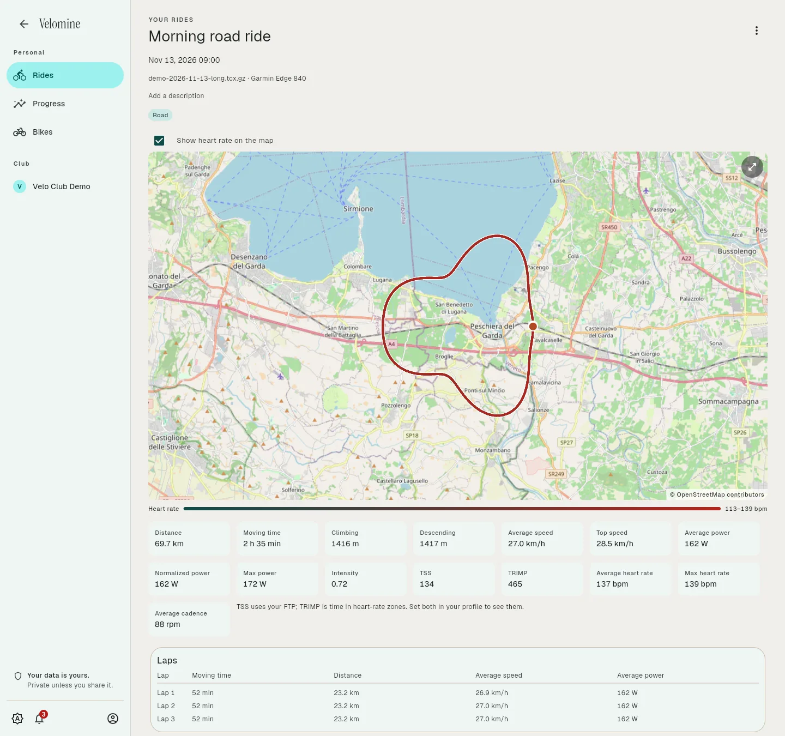
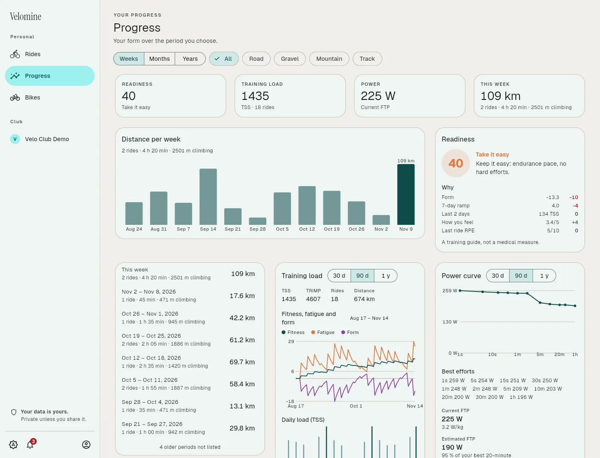
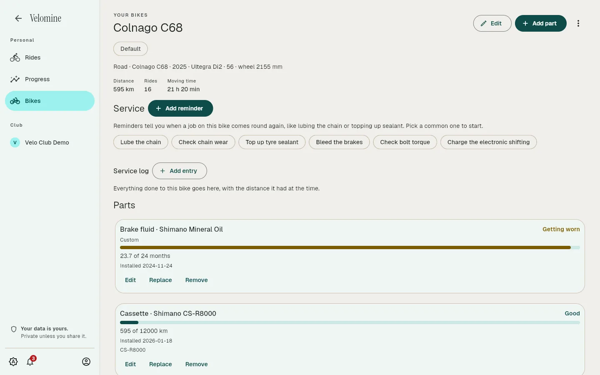

# Velomine

**A self-hosted cycling platform where every ride stays yours, for riders and their clubs.**

[](https://github.com/zenkraker/Velomine/releases/latest) [](LICENSE) [](#quick-start)

[Website](https://velomine.eu) · [Try the demo](https://velomine.eu/demo/) · [What works today](https://velomine.eu/status/) · [Self-host it](#quick-start) · [Give feedback](https://velomine.eu/feedback/)



Velomine reads your rides from a bike computer, the Android app or a Strava export, and turns them into the analysis a cyclist and a coach need — with a power meter or without one: heart rate builds the load when there is no power, and the watts are estimated from speed, slope and weight when there is no power meter either. Clubs get coaches, a ride calendar and a route library, and each rider decides exactly what their coach may see.

## Quick start

Run it on your own computer in about a minute, from the published images:

```
git clone https://github.com/zenkraker/Velomine.git
cd Velomine
VELOMINE_VERSION=0.1.22 docker compose up --no-build
```

Open **http://localhost:8080**, press *Sign in*, and sign in as `admin@velomine.local` with the password `Velomine-dev-1`. Use the newest version from [Releases](https://github.com/zenkraker/Velomine/releases/latest) in place of `0.1.22`. These defaults are for trying it on your own machine; [Self-hosting](https://velomine.eu/docs/self-hosting/) sets it up properly, and [Try it from source](https://velomine.eu/docs/self-hosting/#try-it-from-source) builds it yourself.

The Android app is on the same [Releases](https://github.com/zenkraker/Velomine/releases/latest) page as an APK: install it and type your server's address when it asks.

## Why Velomine

- **Your data is yours.** Export everything, every original file included, or delete everything, whenever you want. Nothing is visible to anyone until you share it, and you can see who looked.
- **No pro tier.** Every feature is included for everyone. You pay to have it hosted, or host it yourself for free.
- **No ads, no data sale, no AI training on your rides.** No public feed, no follower graph, no leaderboards by default.
- **Telemetry is yours to switch on.** Crash and usage data leaves the app only when a member opts in, never carries rides or health data, and can be turned off again. The rest is in [product values](docs/design/values.md).
- **Cycling first.** Power, components, climbing and club rides, not a generic fitness app.
- **Open source** under AGPL-3.0. The cloud and a self-hosted server run the same software.

## What it does today

| | |
|---|---|
|  |  |
| **Progress:** the rider card, weekly and monthly totals, training load, fitness and fatigue, the power curve and FTP, and a daily readiness score. | **Bikes and parts:** every component with its wear, service reminders and a service log. |

- **Rides:** FIT, GPX and TCX files, whole folders at once (Zwift's Activities folder too), or your full Strava export; map, charts, laps, heart-rate and power zones.
- **Clubs and coaches:** join with a code, a coach sees only what each rider shares, planned club rides with a meeting point and a route, and a shared route library.
- **Android app** that records with the screen off and connects to a heart-rate sensor over standard Bluetooth LE, with no vendor app and no ANT+; a missing sensor never blocks a ride. The APK is attached to every [release](https://github.com/zenkraker/Velomine/releases/latest). On an iPhone, the web app works in the browser.
- **Power and endurance analysis:** FTP history with where each value came from, a reminder when the FTP is out of date and a suggestion when a ride shows a higher one, critical power, W′ and peak power, W′ balance through a ride, aerobic decoupling and efficiency factor, easy/moderate/hard time with the polarisation index, and personal power records.
- **Riders without a power meter:** an effort score on every ride, from power, otherwise from heart rate, otherwise from how hard it felt, otherwise watts estimated from speed and slope, so a strap alone builds the fitness chart; heart-rate zones from your threshold, both zone sets adjustable by hand; maximum and threshold heart rate typed by you, measured on a ride or estimated, each with where it came from; watts estimated from speed, slope and weight, always marked as estimated; and a caution when every day was about as hard or the week was much heavier than usual.
- **One rider card** at the top of Progress: FTP and W/kg, critical power, W′ and peak power, your best 5 seconds to 20 minutes (each opening its ride), maximum and threshold heart rate, the efficiency trend of the last eight weeks, the last 90 days of riding, today's fitness and form, and the next event — each with a line saying where it came from.
- **Auto training (experimental):** Velomine plans your week from your own rides. A goal with the reason it was suggested, two hard days a week kept apart from a long ride on your own day, a lighter week every few, and load that grows only after a week you finished; the week carries the effort it plans and what you have already ridden. Each session says what to ride in watts, heart rate and feel, a ride ticks the session it was and scores it against the plan, and you can move a session, skip it with a reason, or make today easy. It is new and still changing: tell us what feels wrong.
- **Events you train for:** a date, a distance and climbing, the days to go, and the ride that turned out to be it.
- **Wellbeing check-in** and readiness, as health data with explicit consent.
- **Accounts:** optional two-factor sign-in, single sign-on, a list of signed-in devices; English and Italian.

It is early: the interface is rough in places, and there are bugs. The iOS recorder, power and speed sensors and automatic sync from Garmin or Wahoo are not built yet. The [status page](https://velomine.eu/status/) keeps the full list.

## How rides are processed

- **Formats:** FIT, GPX and TCX, gzipped or not, one file or a whole folder at once; a FIT file that holds several activities becomes one ride per activity.
- **Strava export:** read on the server from the ZIP, one ride per activity, so importing a newer export skips what is already here. Non-cycling activities are skipped and counted, photos and the other files are ignored, and the archive is deleted when the import finishes.
- **Duplicates:** the same file hash and start time, or a start within two minutes with an elapsed time within a minute and a distance within 200 m or 2 %, whichever is larger, is the same ride from another app or device. It is kept hidden — a single upload says so, an import counts it — and deleting the ride that was kept reads its hidden copies again.
- **Speed** comes from the file's own speed when most samples carry it (a sensor or the device), otherwise from the GPS positions; every ride records which.
- **The numbers** — pauses, normalized power, maximum speed, elevation gain, zones, the effort score and estimated watts — follow [the training models](docs/training-models.md).
- **The original file** is kept as received, forever, so a parser improvement reads older rides again from their own files.

## Self-hosting

Self-hosting is free for riders and clubs, with every feature and no member limit. Everything runs with Docker: the server, the web app and PostgreSQL. The setup, settings, email, backups, upgrades and troubleshooting are in the [documentation](https://velomine.eu/docs/self-hosting/); its source is [docs-site/](docs-site/). An optional [supporter licence](https://velomine.eu/pricing/#supporter) funds the project and unlocks nothing.

Every setting an operator can change, with its default and what it does, is in [`.env.example`](.env.example).

## Develop Velomine

Not needed to run it.

**Recommended: the dev container.** Open the repository in VS Code and choose *Reopen in Container*: the image has .NET, Flutter with the Android SDK, Node, Java, `just`, CodeGraph and the coding agents at pinned versions, and Docker runs inside it, so the stack and the tests work unchanged. `just` runs the everyday commands (`just up`, `just logs`, `just phone`, `just check`). The server always runs in Docker, as in the steps above. [docs/development.md](docs/development.md) says what is inside and how to work with it.

**Without the dev container**, install these yourself:

| Install | For |
|---------|-----|
| **.NET SDK 10** | Building and testing the server (the tests also need Docker; they start their own PostgreSQL and Dex). |
| **Flutter 3.50.0** (comes with Dart 3.14.0) | The app. Run `flutter doctor` to see what else your target needs (Android Studio for Android, Xcode for iOS). |
| **just** | `just check` runs every check before a commit; `just --list` shows the rest. |
| **Java 11 or newer, or Docker** | Regenerating the API client with `tools/generate-api-client.sh`. |
| **Claude Code or Pi, with the ponytail plugin, plus CodeGraph** | Required for working on this repository; see [AGENTS.md](AGENTS.md). |

## Documents

- [Development environment](docs/development.md)
- [Running the demo](docs/demo.md)
- [Architecture](docs/architecture.md)
- [Code, API and app rules](AGENTS.md) and the [full rules](docs/rules/)
- [Product values and scope](docs/design/values.md)
- [Design: the visual language and every screen](docs/design/pages/README.md)

## How it is built

Velomine is built by one developer, with AI coding agents writing much of the code. They work under the written rules in [AGENTS.md](AGENTS.md), and every change passes the tests and checks before it is released.

## Contributing

Feedback is the most useful contribution right now: [tell what worked and what broke](https://velomine.eu/feedback/). For a security problem, see the [security page](https://velomine.eu/security/) instead of opening an issue.

For code, read [AGENTS.md](AGENTS.md) first: it holds the invariants and links to the full rules in `docs/rules/` and the approved libraries in `docs/dependencies/approved.md`. Run `just check` before every commit.

## Licence

Velomine is licensed under the [GNU AGPL-3.0](LICENSE). The Velomine name and marks are reserved: a fork may not present itself as Velomine.
