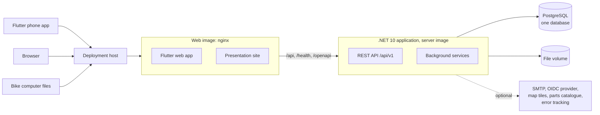
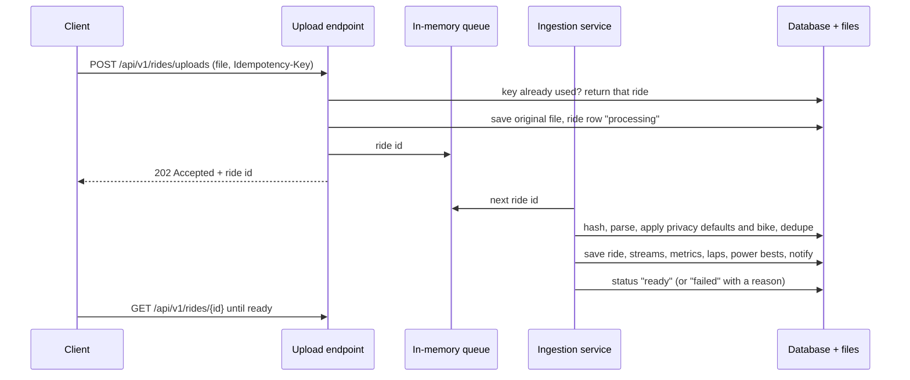
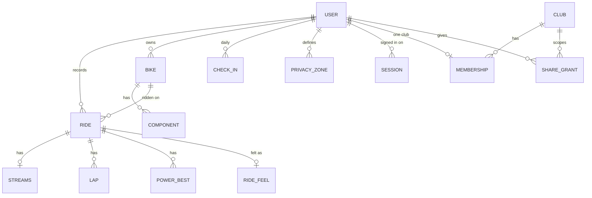

# Velomine architecture

How Velomine is shaped: one application, one database, clubs and members, and how it is deployed. This document describes the system at a high level and records the decisions behind it. The code rules that implement it are in [`AGENTS.md`](../AGENTS.md), the product rules in [values](design/values.md), what works today on the [status page](../src/Velomine.Server/site/status/index.html), and inter-club ideas in [v2](design/v2.md).

It describes only what is decided. Features that are not built yet are on the status page, not here.

## 1. Goals and constraints

- **Simple to run.** One application image and one PostgreSQL database, for the cloud and for a self-hosted club alike. No microservices, brokers, caches or extra services; scale by running more instances behind a proxy.
- **Cycling only.** Every model, screen and metric is about bikes and rides.
- **Private by default.** Nothing a member records is visible to anyone else until the member shares it, and every share can be revoked.
- **Members own their data.** Full export (original files and JSON) and complete deletion, whether or not they belong to a club.
- **Small clubs.** A club has up to about 1,000 members; a cloud deployment serves many such clubs.
- **Official before community.** .NET, ASP.NET Core, EF Core and official libraries first (the rule is in `AGENTS.md`).

## 2. System context

PostgreSQL is storage only. The file volume holds the original ride files. Everything outside the box is optional and configured by the operator; OpenStreetMap tiles are the default map.

## 3. Clubs, members and isolation

**Decision: one database and one schema for both deployments.** The cloud runs one shared database with many clubs; a self-hosted club runs the same schema with one club. There is no tenant catalog, no database per club and no host-based tenant resolution, so there is one migration path and one code path.

- **The member is the owner, the club is a group.** An account exists on its own and may join one club. Rides, bikes, goals, wellbeing and the profile belong to the member and stay theirs if they leave or the club is deleted.
- **Club tables carry `club_id`.** Clubs, memberships, join requests and sharing grants are scoped by club, and every query on them is limited to the caller's clubs.
- **Membership shows the roster and nothing else.** A coach sees a member's rides, training, routes or wellbeing only through an active grant the member gave for that data type. Club admins administer the club; they do not read members' data.
- **Discovery is local and opt-in.** Clubs on the same deployment can opt into nearby discovery, and a rider asks to join; the owner approves. Discovery between deployments (cloud and self-hosted clubs) belongs to the inter-club layer in [v2](design/v2.md).

Trade-offs accepted: isolation depends on query filters, with tests proving one club cannot see another's data, instead of separate databases, and restoring a single club from a shared backup means restoring to a scratch database and copying that club's rows.

## 4. Deployment

- **Two Docker images, one origin** (amd64, non-root). The **server image** holds the .NET API and the background services, and no front-end. The **web image** is the official nginx image with the Flutter web build and the presentation site: it serves both and forwards `/api`, `/health` and `/openapi` to the server, so the browser sees one address and the cookie and single sign-on need no cross-origin setup. Both images share one version and are released together.
- **Cloud:** one deployment in the EU/EEA over a managed PostgreSQL database, behind TLS. **Self-host:** the same two images with PostgreSQL as a third container or an existing server, and one volume for files. Both run the same features; only the operator differs.
- **Volumes:** ride files on `/data/files`, the Data Protection key ring on `/data/keys`. Every instance mounts the same key ring, because it signs the session cookies and download links.
- **Background work runs on exactly one instance** (`VELOMINE__BACKGROUND__ENABLED`); migrations run on every instance under EF Core's migration lock.
- **Configuration** is environment variables, validated on start. Secrets come from the environment or a secret store, never the database.
- **Migrations** are backward-compatible for one release (expand, backfill, contract). A database rollback is a restore, not a downgrade.
- **Releases** use exact image versions, never `latest`, and can be rolled back to the previous version.
- **Backups:** the database (point-in-time recovery where the host offers it, plus a nightly `pg_dump -Fc`), the file volume and the Data Protection key ring. Deleted data leaves the backups within 90 days.
- **Supporter licence (self-host):** self-hosting is free. An optional supporter licence is paid once by a rider or yearly by a club; the offline signed key names the holder and, for a club, an expiry, is validated with a public key and shows a badge the holder can hide. It unlocks no feature, has no seat count and never phones home; a server without one works exactly the same.
- **Hosted environments:** one VPS runs a Traefik compose and one compose project per environment. Traefik owns ports 80 and 443, gets and renews the Let's Encrypt certificates, and routes each host name to that environment's web container; it reads the routes from labels in each environment's compose through the Docker socket, mounted read-only. Only web containers join Traefik's shared `proxy` network: each environment's server sits on that environment's own network, so no environment can reach another's server. One managed PostgreSQL instance holds the databases, reached over the private network.
- **Only the demo runs for now.** The VPS (STARDUST1-S) and database instance that host the demo are the shared ones; the demo keeps its `velomine` database. dev, staging and prod are described in `deploy/host/` and commented out in OpenTofu. Turning another environment on means uncommenting it, resizing the VPS, and giving it its own database and user on the same instance; prod then answers at `app.velomine.eu`. `velomine.eu` and `www` are served by the demo until prod launches. The infrastructure (`infra/`) and host files (`deploy/host/`) live in this repository; their secrets do not.
- **Releases:** CI builds and smoke-tests the server and web images per commit, together, and pushes them to GHCR with their build provenance. A tag `vX.Y.Z` publishes version `X.Y.Z`. Deploying is manual: the operator sets that version for an environment on the host and runs `docker compose pull` and `up --wait`, which fails unless the pair answers `/health`; a rollback is the same with the previous version. GitHub holds no key to the hosts.
- No Kubernetes, no multi-cloud, no active-active.

## 5. Ride ingestion

Every ride arrives the same way, whether from the phone, the web upload or a file from a bike computer.

The original file is saved before `202` is returned, and on start the service re-queues every ride still processing, so a restart never loses a ride. Originals are kept forever, so rides can be read again when a parser improves.

## 6. Background work

Everything runs inside the application as hosted services; PostgreSQL holds data, not a job system.

- **Ingestion:** the queue above.
- **Timers:** email notifications (batched so a burst becomes one email), the parts catalogue sync, part contributions to the catalogue publisher, the sharing view log (three months) and ended sessions (a week). Each timer recomputes its work from the data, so a missed run is caught up next time.
- **Parts catalogue:** one list maintained by a publisher, mirrored every hour. Members never write to it. A part the list does not have waits in a table until the publisher answers, because losing it would mean asking the member to type it again. Only the part itself is sent: no member, bike, club or address.

Most numbers are computed when asked for (wear, totals, goals). Training load and power bests are stored per ride, because the dashboard and power curve sum them over long ranges.

## 7. Data ownership

- **Export** covers everything a member owns, with every original ride file byte for byte.
- **Account deletion** removes the account and everything it owns, then each ride file no other ride uses.
- **Club deletion** removes the club, its memberships and grants. Members keep their accounts and data.

## 8. Security model

- Access to member data is owner or an active grant for that data type and audience; checked on every endpoint that returns it.
- Everything a non-owner sees passes through one privacy function: privacy zones around saved places, start and end trimming, per-stream switches, and no position data without a route grant.
- Wellbeing is health data: explicit, versioned consent; notes never leave the owner.
- Every coach view of a member's data is logged, and the member can read the log.
- Sessions are listed and revocable per device; refresh tokens rotate and a reused one ends the session.
- Operational logs never contain member data. Member telemetry from the app is opt-in; server telemetry is anonymised and used only to fix bugs and performance problems.

## 9. Clients

- **One Flutter codebase** for Android, iOS and the web app. The web app is served by the web image at the same address as the API, so cookie sessions and single sign-on need no cross-origin setup.
- **The presentation site** is plain HTML in `site/`, served by the web image, with no JavaScript, no cookies, no analytics and no third-party scripts, because Flutter web cannot be crawled or previewed.
- **The phone records natively** (Kotlin, Swift) with the screen off, pairs standard Bluetooth LE sensors without vendor apps, saves each ride as a FIT file first and uploads it through an idempotent queue.
- **Design system:** a day theme (Cloud Dancer, deep teal, iron oxide) and a night-ride theme (asphalt, Volt) for recording.

## 10. Decisions

| Decision | Why |
|----------|-----|
| One database for cloud and self-host, clubs scoped by `club_id` | One code and migration path; a self-hosted club is the same system with one club. |
| A club plan: member limit and paid-until, set by the operator and later by a payment webhook | Admission is one checked step with the club row locked; a full or ended plan stops new members without taking anything from existing ones, and no price lives in the server. |
| Vertical slices in one project, with FastEndpoints | Each use case is one file; no layers to keep in sync. |
| One PostgreSQL schema per feature area | Keeps a large database readable without splitting it. |
| Background work in the application; PostgreSQL is storage only | No extra service to run or monitor. |
| Dart API client generated from the OpenAPI document | The app cannot drift from the server's contract. |
| Flutter for every logged-in screen, web included; plain HTML for the public site | One language and design system for phone and web. Revisit if the web app grows heavy data tables, accessibility audits become a requirement, or a web developer without Dart joins. |
| Original ride files kept forever; FIT as the phone's format | Any ride can be read again when a parser improves. |
| Streams as one row per ride with an array per signal | A long ride is one row fetch. Revisit if queries must filter single samples across rides. |
| Wear, goals and totals computed on read; load and power bests stored | Always correct for the current profile, except the sums the dashboard needs fast. |
| Recurring maintenance jobs reuse the part-wear calculation | One set of interval rules for parts and service jobs; the reminder stores only its interval and last-done date, and the rest comes from the rides. |
| Optional, offline, signed supporter licence | Funds the project without a paywall: no phone-home, no seats, never a feature or a block on member data. |
| Member telemetry opt-in; operational logs separate and anonymous | Health and location data never leave through diagnostics. |
| Two images, server and web, behind one origin | A Flutter build never blocks or slows a server image, and the server is API-only. One origin keeps the cookie and single sign-on simple. Costs a third container for self-hosters. |
| Another app's history comes from the member's own export, never that app's API | The bulk export is the data the member downloads themselves, needs no token or outside service, and keeps a self-hosted instance independent. A ride records its source and that app's activity id, so a later export skips what is already here. |
| Quiet bulk import: a `Bulk-Import` header and a token-bucket upload limit | A dropped bike computer folder sends many files at once; the member gets one summary instead of a notification per file, while the sustained rate stays capped. |
| `sharing.view_log.ride_id`, set null when the ride goes | "Who looked" is kept per ride, and deleting a ride must not delete the member's record that someone looked. |
| The presentation site ships in the web image, as plain HTML in `site/` | It is static front-end material; it stays plain HTML because Flutter web draws on a canvas, which is poor for search, link previews, first load and accessibility. |
| nginx inside the web image; Traefik at the hosts' edge | nginx serves the static files and forwards the API, the same for a self-hoster and on the hosts. Traefik gives each environment its route through labels in its own compose and handles certificates itself. The read-only Docker socket gives Traefik a lot of power over the host: revisit (file provider or a socket proxy) before prod holds a club's real data. |
| Hosted environments and their pipelines in this repository, secrets outside it | Environments differ only by settings and secrets, so a second repository would only add drift. GitHub holds no host secret. |
| Build once in CI; deploy by hand with `docker compose` | Every environment runs a version CI built and tested, never a rebuild. With no customers yet, a manual pull and `up --wait` is the simplest deploy with no deploy key, timer or script to maintain; automate it when deploys become frequent. |
| One VPS and one database instance for every environment; only the demo runs until there are customers | No cost for environments nobody uses yet. The others are written out and commented out, so turning one on is uncommenting, not designing. Commented-out code is not checked by CI or `tofu validate`: check it when turning it on. The public demo will live next to prod: revisit before prod holds a club's real data, when prod moves to its own VPS and an HA database. |
