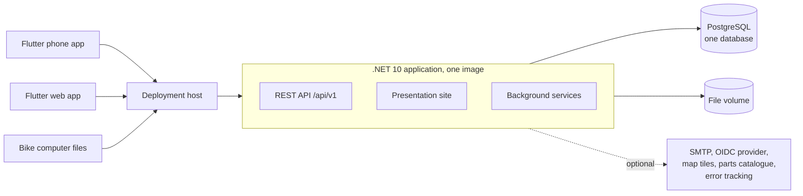
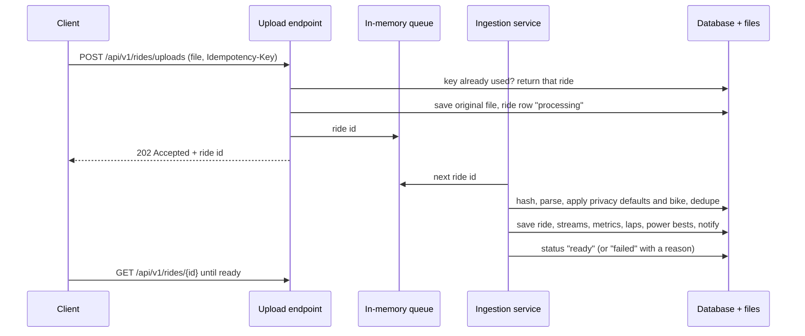
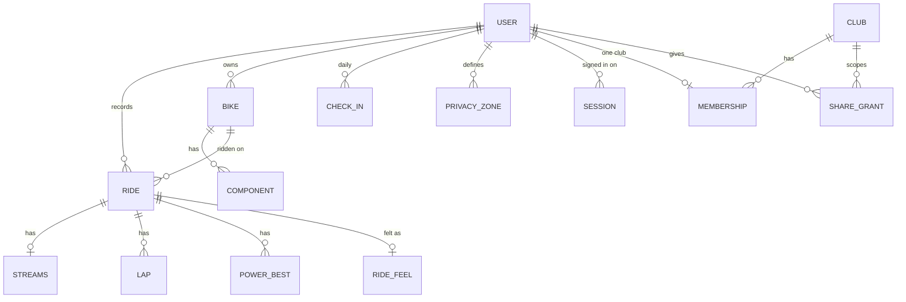

# Velomine architecture

How Velomine is shaped: one application, one database, clubs and members, and how it is deployed. This document describes the system at a high level and records the decisions behind it. The code rules that implement it are in [`AGENTS.md`](../AGENTS.md), the product rules in [values](design/values.md), what works today in the [README](../README.md), and inter-club ideas in [v2](design/v2.md).

It describes only what is decided. Features that are not built yet are on the README roadmap, not here.

## 1. Goals and constraints

- **Simple to run.** One application image and one PostgreSQL database, for the cloud and for a self-hosted club alike. No microservices, brokers, caches or extra services; scale by running more instances behind a proxy.
- **Cycling only.** Every model, screen and metric is about bikes and rides.
- **Private by default.** Nothing a member records is visible to anyone else until the member shares it, and every share can be revoked.
- **Members own their data.** Full export (original files and JSON) and complete deletion, whether or not they belong to a club.
- **Small clubs.** A club has up to about 1,000 members; a cloud deployment serves many such clubs.
- **Official before community.** .NET, ASP.NET Core, EF Core and official libraries first (the rule is in `AGENTS.md`).

## 2. System context

PostgreSQL is storage only. The file volume holds the original ride files. Everything outside the box is optional and configured by the operator; OpenStreetMap tiles are the default map.

## 3. Clubs, members and isolation

**Decision: one database and one schema for both deployments.** The cloud runs one shared database with many clubs; a self-hosted club runs the same schema with one club. There is no tenant catalog, no database per club and no host-based tenant resolution, so there is one migration path and one code path.

- **The member is the owner, the club is a group.** An account exists on its own and may join one club. Rides, bikes, goals, wellbeing and the profile belong to the member and stay theirs if they leave or the club is deleted.
- **Club tables carry `club_id`.** Clubs, memberships, join requests and sharing grants are scoped by club, and every query on them is limited to the caller's clubs.
- **Membership shows the roster and nothing else.** A coach sees a member's rides, training, routes or wellbeing only through an active grant the member gave for that data type. Club admins administer the club; they do not read members' data.
- **Row-level security is the second line.** PostgreSQL row-level security on the club tables backs up the query filters, so a missing filter fails closed. Tests prove one club cannot see another's data either way.
- **Discovery is local and opt-in.** Clubs on the same deployment can opt into nearby discovery, and a rider asks to join; the owner approves. Discovery between deployments (cloud and self-hosted clubs) belongs to the inter-club layer in [v2](design/v2.md).

Trade-offs accepted: isolation depends on query filters and row-level security instead of separate databases, and restoring a single club from a shared backup means restoring to a scratch database and copying that club's rows.

## 4. Deployment

- **One Docker image** (amd64, non-root) with the API, the Flutter web build, the presentation site and the background services.
- **Cloud:** one deployment over a managed PostgreSQL database, behind TLS. **Self-host:** the same image with PostgreSQL as a second container or an existing server, and one volume for files. Both run the same features; only the operator differs.
- **Volumes:** ride files on `/data/files`, the Data Protection key ring on `/data/keys`. Every instance mounts the same key ring, because it signs the session cookies and download links.
- **Background work runs on exactly one instance** (`VELOMINE__BACKGROUND__ENABLED`); migrations run on every instance under EF Core's migration lock.
- **Configuration** is environment variables, validated on start. Secrets come from the environment or a secret store, never the database.
- **Migrations** are backward-compatible for one release (expand, backfill, contract). A database rollback is a restore, not a downgrade.
- **Releases** use exact image versions, never `latest`, and can be rolled back to the previous version.
- **Backups:** the database (point-in-time recovery where the host offers it, plus a nightly `pg_dump -Fc`), the file volume and the Data Protection key ring. Deleted data leaves the backups within 90 days.
- **Supporter key (self-host):** self-hosting is free. An optional supporter key, offline and signed, names the holder (a rider or a club) and an expiry, is validated with a public key and shows a supporter badge. It unlocks no feature, has no seat count and never phones home; a server without one works exactly the same.
- **Operations** (hosting, inventory, secrets, backups, runbooks, billing) live in a private ops repository. This repository holds only what a self-hoster needs.
- No Kubernetes, no multi-cloud, no active-active.

## 5. Ride ingestion

Every ride arrives the same way, whether from the phone, the web upload or a file from a bike computer.

The original file is saved before `202` is returned, and on start the service re-queues every ride still processing, so a restart never loses a ride. Originals are kept forever, so rides can be read again when a parser improves.

## 6. Background work

Everything runs inside the application as hosted services; PostgreSQL holds data, not a job system.

- **Ingestion:** the queue above.
- **Timers:** email notifications (batched so a burst becomes one email), the parts catalogue sync, part contributions to the catalogue publisher, the sharing view-log retention and session cleanup. Each timer recomputes its work from the data, so a missed run is caught up next time.
- **Parts catalogue:** one list maintained by a publisher, mirrored every hour. Members never write to it. A part the list does not have waits in a table until the publisher answers, because losing it would mean asking the member to type it again. Only the part itself is sent: no member, bike, club or address.

Most numbers are computed when asked for (wear, totals, goals). Training load and power bests are stored per ride, because the dashboard and power curve sum them over long ranges.

## 7. Data ownership

- **Export** covers everything a member owns, with every original ride file byte for byte.
- **Account deletion** removes the account and everything it owns, then each ride file no other ride uses.
- **Club deletion** removes the club, its memberships and grants. Members keep their accounts and data.

## 8. Security model

- Access to member data is owner or an active grant for that data type and audience; checked on every endpoint that returns it.
- Everything a non-owner sees passes through one privacy function: privacy zones around saved places, start and end trimming, per-stream switches, and no position data without a route grant.
- Wellbeing is health data: explicit, versioned consent; notes never leave the owner.
- Every coach view of a member's data is logged, and the member can read the log.
- Sessions are listed and revocable per device; refresh tokens rotate and a reused one ends the session.
- Operational logs never contain member data. Member telemetry from the app is opt-in; server telemetry is anonymised and used only to fix bugs and performance problems.

## 9. Clients

- **One Flutter codebase** for Android, iOS and the web app. The web app is served by the server at the same address as the API, so cookie sessions and single sign-on need no cross-origin setup.
- **The presentation site** is plain server-served HTML with no JavaScript, because Flutter web cannot be crawled or previewed.
- **The phone records natively** (Kotlin, Swift) with the screen off, pairs standard Bluetooth LE sensors without vendor apps, saves each ride as a FIT file first and uploads it through an idempotent queue.
- **Design system:** a day theme (Cloud Dancer, deep teal, iron oxide) and a night-ride theme (asphalt, Volt) for recording.

## 10. Decisions

| Decision | Why |
|----------|-----|
| One database for cloud and self-host, clubs scoped by `club_id` and row-level security | One code and migration path; a self-hosted club is the same system with one club. |
| Vertical slices in one project, with FastEndpoints | Each use case is one file; no layers to keep in sync. |
| One PostgreSQL schema per feature area | Keeps a large database readable without splitting it. |
| Background work in the application; PostgreSQL is storage only | No extra service to run or monitor. |
| Dart API client generated from the OpenAPI document | The app cannot drift from the server's contract. |
| Flutter for every logged-in screen, web included; plain HTML for the public site | One language and design system for phone and web. Revisit if the web app grows heavy data tables, accessibility audits become a requirement, or a web developer without Dart joins. |
| Original ride files kept forever; FIT as the phone's format | Any ride can be read again when a parser improves. |
| Streams as one row per ride with an array per signal | A long ride is one row fetch. Revisit if queries must filter single samples across rides. |
| Wear, goals and totals computed on read; load and power bests stored | Always correct for the current profile, except the sums the dashboard needs fast. |
| Optional, offline, signed supporter key | Funds the project without a paywall: no phone-home, no seats, never a feature or a block on member data. |
| Member telemetry opt-in; operational logs separate and anonymous | Health and location data never leave through diagnostics. |
