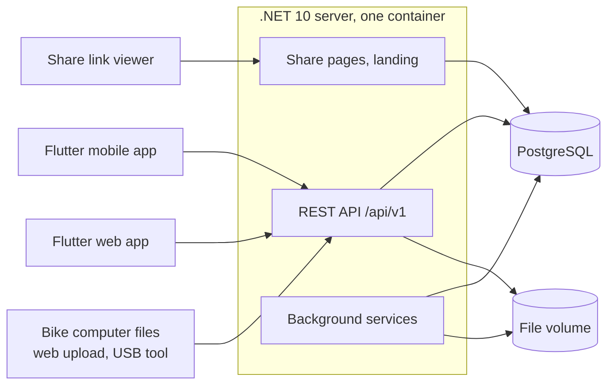
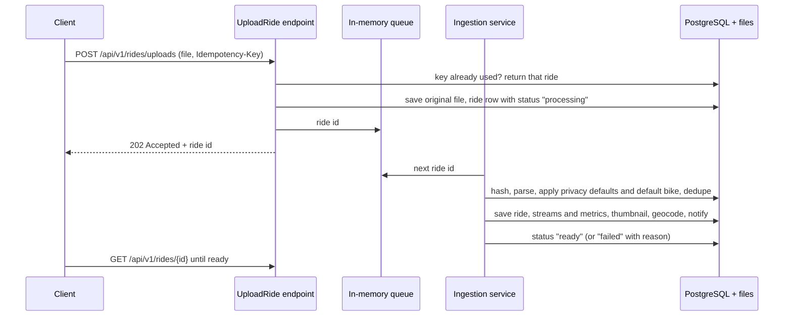
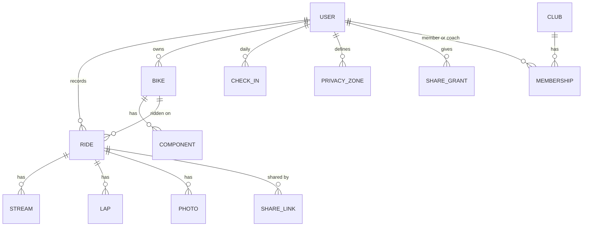
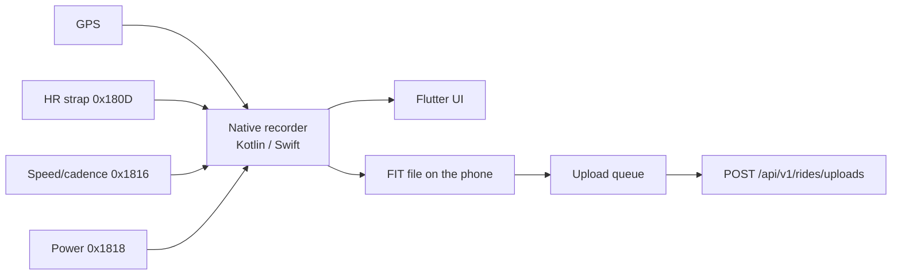

# Velomine architecture

How Velomine is built: server, apps, share pages and deployment. Keep it simple: one server, one database, vertical slices.

This document describes the design, not progress. Scope labels (v1, v2) only say which release a part belongs to; the plan is in [v1 scope and architecture](design/v1-scope-and-architecture.md). Rules in [`CLAUDE.md`](../CLAUDE.md) override anything here.

## 1. Goals and constraints

- **Small and self-hosted.** A club volunteer runs one container plus PostgreSQL, configured with environment variables. An instance serves up to about 1,000 members.
- **Cycling only.** Every model, screen and metric is about bikes and rides.
- **Private by default.** Nothing a member records is visible to anyone else until the member shares it, and every share can be revoked.
- **Members own their data.** Full export (original files + JSON) and complete deletion.
- **Don't reinvent the wheel.** Use what .NET, ASP.NET Core, EF Core and official Microsoft libraries already provide. Write it yourself only when nothing official fits.
- **Clean-room.** Endurain's ideas, never its code.

## 2. System context



PostgreSQL is storage only. The file volume holds original ride files, photos and thumbnails. Optional outside services: SMTP, an OIDC identity provider, a map tile server, and v2 connectors (Garmin, Wahoo, Dropbox, Nextcloud).

## 3. Deployment

- One Docker image (amd64, arm64, non-root) with the API, share pages, the Flutter web build as static files, and the background services.
- PostgreSQL as a second container or an existing server.
- One mounted volume for files.
- Environment variables only, validated on start with `IOptions<T>` validation.
- EF Core migrations applied on start.
- Health checks with the built-in ASP.NET Core health checks.
- Backup: `pg_dump` plus a copy of the file volume.

## 4. Server: vertical slices

One project. Code is grouped by feature, and each use case is one slice: request, response, validation, endpoint and logic together in one file. Endpoints use [FastEndpoints](https://fast-endpoints.com/).

```
src/Velomine.Server/
  Program.cs
  Data/VelomineDbContext.cs      one DbContext; each feature area maps its tables to its own schema
  Features/
    Rides/UploadRide.cs          Endpoint<UploadRideRequest, UploadRideResponse>
    Rides/GetRide.cs
    Rides/Ingestion/             parsers and the ingestion background service
    Bikes/  Wellbeing/  Clubs/  Sharing/  Privacy/  Analytics/  Accounts/  Notifications/  Admin/
tests/Velomine.Server.Tests/
app/                             Flutter app (section 9)
```

- A slice uses `VelomineDbContext` directly. No repositories, services layers or mediators.
- Code moves to a shared place only when a second slice needs it.
- Each feature area keeps its tables in its own PostgreSQL schema (`rides`, `bikes`, …). Slices may read other areas' tables when they need to; the schema only keeps the database readable.

### Feature areas

| Area | What it holds | Scope |
|------|---------------|-------|
| Accounts | Users, roles (admin, member, coach), invites with admin approval, MFA, OIDC login, scoped API keys, session list with "log out other devices", profile (weight) | v1; passkeys v2 |
| Clubs | Clubs, members, coaches, share grants per data type and audience, revocation, view log | clubs v1; grants v2 |
| Rides | Rides, ride types, streams, laps, HR and power zones, photos, upload and ingestion | v1; connectors v2 |
| Bikes | Bikes, wheel circumference, default bike per ride type, components, wear by km, hours and months | v1; reminders v2 |
| Wellbeing | Daily check-in, RPE and notes per ride | v1; cycle tracking v2 |
| Analytics | NP, IF, TSS, TRIMP, manual FTP, totals, goals per week/month/year (scope to confirm) | v1; power curve, estimates, fitness/fatigue/form, readiness v2 |
| Privacy | Privacy zones, start/end trimming, per-stream switches | v1 |
| Sharing | Share links and the server-rendered share pages | v1 |
| Notifications | In-app notifications and email | v1 |
| Admin | Server settings, map tiles, SMTP, OIDC, user approval | v1 |

## 5. Ride ingestion

Every ride arrives the same way: phone app, web upload, USB tool or (v2) a connector.



- **Queue:** a `System.Threading.Channels` channel read by a `BackgroundService`. On startup the service re-queues every ride still in `processing`. The original file is saved before `202` is returned, so a restart never loses a ride.
- **Parsing:** FIT with `Garmin.FIT.Sdk`; GPX and TCX with the BCL XML APIs, reading every common extension (`gpxtpx:hr`, `cad`, `speed`, `atemp`, `PowerInWatts`).
- **Speed source:** each ride records whether speed came from a wheel sensor or GPS. The wheel sensor wins when present.
- **Privacy defaults and default bike** are copied onto the ride at import, so changing the defaults later never exposes old rides.
- **Multi-activity FIT:** one file can hold several rides; each becomes its own ride.
- **Duplicates:** the key is the connector ride id, otherwise the file hash plus the start time (the start time keeps rides from one multi-activity file apart). With no key, a ride with the same start time counts as a duplicate. A likely duplicate is kept hidden and the member is notified.
- **Thumbnail and geocoding** run in the same pass. If the tile server or geocoder is unavailable, the ride stores a next-attempt time and a timer retries (section 6). Reverse geocoding is off by default; the admin picks Nominatim, Photon or their own instance, and its rate limit is respected.
- **Idempotency:** the `Idempotency-Key` header (the phone sends its local ride id) makes retries safe.
- **Re-parse:** originals are kept forever, so an admin can re-run ingestion on all rides when a parser improves.

### Metrics

Each formula is covered by tests against known values.

- **NP:** the device's NP from the FIT file when present. Otherwise a 30-second rolling average over the power stream resampled to 1 Hz, then the mean of the fourth powers, then the fourth root. (Endurain skips the rolling average, which overstates NP on spiky rides.) IF and TSS come from NP and FTP.
- **Max speed:** the maximum of 5-sample sliding medians, so one GPS glitch never becomes the max.
- **Elevation gain and loss:** median filter, then moving average, then the sum of changes above a threshold.
- **Moving time:** the sum of gaps between samples, skipping pauses and duplicate or out-of-order timestamps.
- **Zones:** HR zones as percentages of max HR (default 220 − age); power zones from FTP.

## 6. Background work

All background work runs inside the server as hosted services:

- **Ingestion:** the channel reader above.
- **Timers** (`PeriodicTimer` in a `BackgroundService`): thumbnail and geocoding retries (rides whose next-attempt time has passed), maintenance reminders, expired share link cleanup, v2 connector polling.
- Email goes out from the same process with the configured SMTP server.

Nothing is queued in the database. A timed task recomputes what it needs from the data on each run, so a missed run is simply caught up next time.

**Computed on read, never stored:** component wear (km, hours and months since fitting), goals and weekly/monthly/yearly totals are calculated from the rides when asked for, using each ride's local date and the member's first day of the week. The reminder timer runs the same calculation.

## 7. Data

Main entities:



- Instants are `timestamptz` in UTC; a ride also stores its local time zone offset. SI units internally.
- Keys are `uuid`; rides recorded on the phone keep the phone's id.
- Rides carry an EF Core concurrency token, so two edits of the same ride can't silently overwrite each other.
- Streams are the largest data. Their storage format (one array column per stream, or one row per sample) is chosen by measuring before the Rides schema is fixed. Endurain stores one JSON array per stream per ride, which supports the array-column option.
- A bulk import (v2, Strava export) has one import row with files done and failed, for the progress bar.
- Export and account deletion are one slice each and cover every schema.

## 8. API

- REST under `/api/v1`, built with FastEndpoints. Validation with FastEndpoints' built-in validators. Errors as `ProblemDetails`.
- The OpenAPI document comes from `FastEndpoints.OpenApi`, which uses Microsoft's `Microsoft.AspNetCore.OpenApi`. It is emitted as OpenAPI 3.0, and DTOs stay flat (no `allOf`/`oneOf`, no inheritance), because the Dart generator does not support 3.1 nullability or schema composition.
- **The Dart client is generated** from that document into `app/lib/core/api/generated/` and never edited by hand. CI regenerates it and fails if the committed copy differs. The generator is chosen in `docs/dependencies/`.
- A released version is never broken, because phones update late. Breaking changes go to `/api/v2`.
- Auth: Identity cookie for the web app, bearer tokens for the mobile app, scoped API keys (`X-API-Key`) for tools such as the USB uploader.

## 9. Security and privacy

- Every endpoint that returns member data checks: owner, or an active grant for that data type and audience. Admins do not see members' rides or wellbeing.
- Data seen by anyone other than the owner (share links, club, coach) goes through one privacy function in `Features/Privacy/` that applies privacy zones (saved places, up to 1 mile), start/end trimming and per-stream switches. It covers both the summary fields (start time, place, bike, HR, power and cadence values, private notes) and the streams, in one place. The owner always sees the full track.
- Images on share pages (thumbnails, photos) use signed, expiring URLs from Data Protection (`ITimeLimitedDataProtector`, one purpose per feature). Hiding a map never deletes the file; non-owners just never get a URL for it.
- Outbound URLs entered by an admin (tile server, OIDC issuer, geocoder, connectors) are refused if they point to private or loopback addresses, unless the admin explicitly allows it.
- Every non-owner view is logged and visible to the member.
- Cycle tracking (v2) is encrypted with ASP.NET Core Data Protection, never appears in share links, and has its own grant.
- Wellbeing and cycle data are health data: explicit consent before first use.
- Built-in ASP.NET Core rate limiting on login and upload. Secrets only in environment variables. No telemetry or third-party calls unless an admin turns them on.

## 10. Flutter apps

One Dart codebase builds Android, iOS and the web app.

```
app/
  lib/
    main.dart
    core/       generated API client, auth, design system, charts, maps, i18n (en, it)
    features/   rides/, bikes/, wellbeing/, clubs/, sharing/, admin/, upload/, recording/
  android/      Kotlin recorder service
  ios/          Swift recorder
```

- **Design system:** a day theme (Cloud Dancer, deep teal, iron oxide) and a night-ride theme (asphalt, Volt) for recording.
- **State:** Flutter SDK primitives. **Navigation:** `go_router`.
- **Platform split:** recording, Bluetooth and local storage are mobile only. The web app adds drag-and-drop upload and admin screens.

### Mobile recorder



- The native recorder keeps GPS and sensors running with the screen off and survives the app being closed.
- Speed and distance come from wheel revolutions × the bike's wheel circumference when a speed sensor is paired, otherwise from GPS.
- The ride is saved on the phone as FIT first. The queue uploads it when there is signal and retries until the server confirms.
- Auto-pause and audio announcements run in the recorder. Bluetooth only, no ANT+.

## 11. Connectors (v2)

A timer per connector (Garmin personal key, Wahoo cloud, Dropbox or Nextcloud folder) fetches new FIT files and passes them to the same ingestion as an upload. Credentials are stored encrypted with Data Protection and can be removed at any time.

## 12. Community libraries

Each needs an evaluation in `docs/dependencies/` and owner approval before use.

| Need | Library | State |
|------|---------|-------|
| Endpoints | FastEndpoints, FastEndpoints.OpenApi | Approved, see `docs/dependencies/APPROVED.md` |
| Dart client generator | OpenAPI Generator 7.26.0 (`dart` target) | Approved, see `docs/dependencies/APPROVED.md`; server must emit OpenAPI 3.0 |
| EF Core provider for PostgreSQL | `Npgsql.EntityFrameworkCore.PostgreSQL` | Needs evaluation |
| Bluetooth LE in Flutter | `universal_ble` or similar | Needs evaluation |
| Map widget | `flutter_map` | Needs evaluation |
| Charts | a chart package, or custom painting | Needs evaluation |
| Local storage on mobile | `sqflite`, or plain files | Needs evaluation |

## 13. Decisions to record as ADRs

1. Vertical slices in one server project, with FastEndpoints.
2. Background work in the server; PostgreSQL is storage only.
3. One PostgreSQL schema per feature area.
4. Dart API client generated from the OpenAPI document.
5. Flutter web for the logged-in web app; server-rendered HTML for share and landing pages.
6. Original ride files kept forever; FIT as the format recorded on the phone.
7. Stream storage format (after measuring).
8. Wear, goals and totals computed on read.
