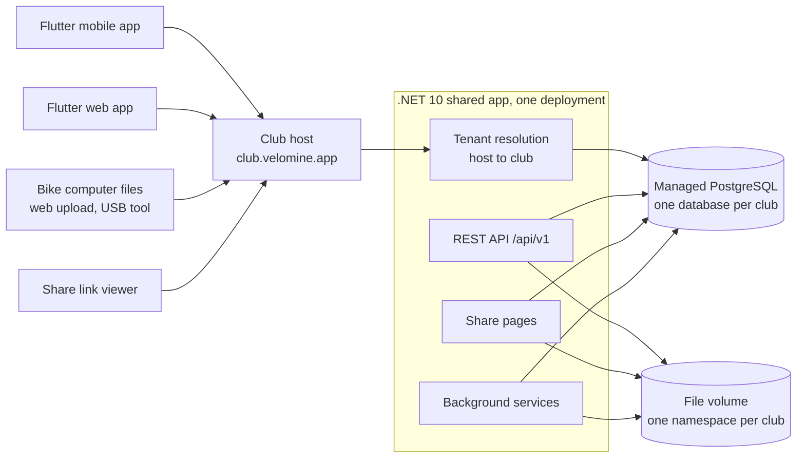
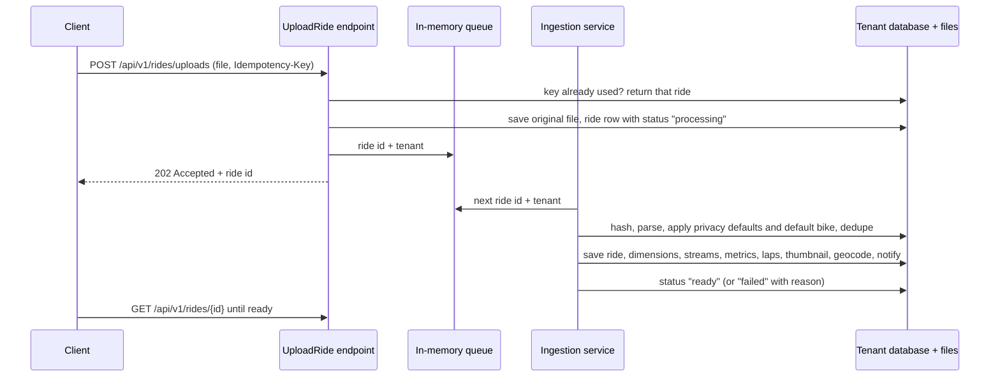
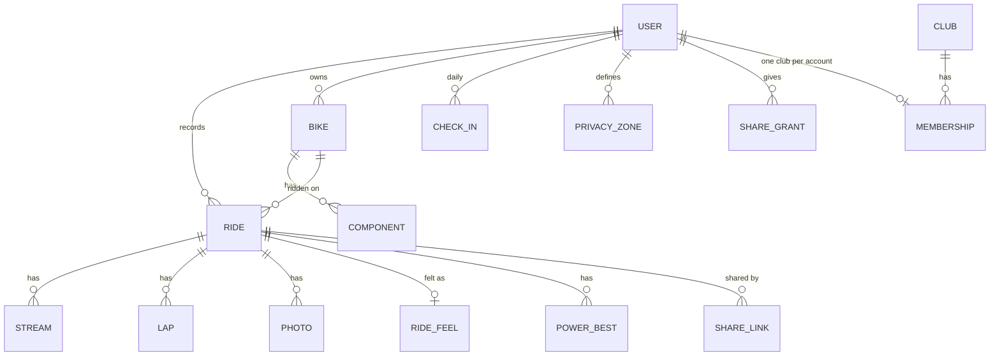
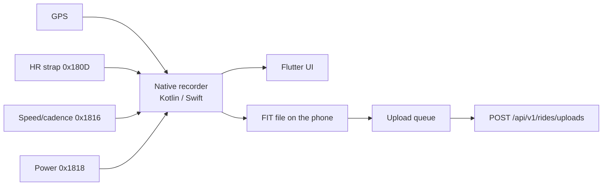

# Velomine architecture

How Velomine is built: server, apps, share pages and deployment. Keep it simple: one shared application, one database per club, vertical slices.

This document describes the design, not progress. Scope labels (v1, v2) only say which release a part belongs to; the plan is in [v1 scope and architecture](design/v1-scope-and-architecture.md), the product rules are in [values](design/values.md), and inter-club ideas are in [v2](design/v2.md). Code, test and dependency rules in [`AGENTS.md`](../AGENTS.md) override anything here for code; this document is the architecture reference.

## 1. Goals and constraints

- **Small and per-club.** Cloud runs one shared application deployment over a managed PostgreSQL cluster, with one database and role per club. Self-host runs the same image as a single-tenant instance. Each club serves up to about 1,000 members.
- **One club, one database.** A club is the tenant: its own PostgreSQL database, role and file namespace. Two clubs never share a database. The tenant is resolved from the host before authentication; the application never scopes rows with a `club_id`.
- **One application service.** A single image provides the API, the web app, share pages and background work. No microservices, brokers, caches or extra services; scale by running more instances behind a proxy.
- **Cycling only.** Every model, screen and metric is about bikes and rides.
- **Private by default.** Nothing a member records is visible to anyone else until the member shares it, and every share can be revoked.
- **Members own their data.** Full export (original files + JSON) and complete deletion.
- **Don't reinvent the wheel.** Use what .NET, ASP.NET Core, EF Core and official Microsoft libraries already provide. Write it yourself only when nothing official fits.

## 2. System context



PostgreSQL is storage only. A managed cluster holds one database and role per club; the tenant catalog maps a host to its database and file namespace. The file volume holds original ride files, photos and thumbnails under a per-club prefix. Optional outside services: SMTP, an OIDC identity provider, a private map tile server (OpenStreetMap is the default), and v2 connectors (Garmin, Wahoo, Dropbox, Nextcloud).

## 3. Deployment

- One Docker image (amd64, non-root) with the API, share pages, the Flutter web build as static files, and the background services.
- **Cloud:** one shared deployment, plus a canary deployment for releases, over a managed PostgreSQL cluster. Each club gets one database and one role. Wildcard DNS and TLS cover `club.velomine.app`; custom domains come later.
- **Self-host:** the same image as a single-tenant instance, with PostgreSQL as a second container or an existing server, and one mounted volume for files.
- A tenant catalog (host, club, database, secret reference, tier and licence) is platform configuration. It is backed up and restored with the deployment.
- Environment variables, validated on start with `IOptions<T>` validation. Per-club SMTP and OIDC overrides come from a per-tenant secret store, never the database.
- Migrations run per tenant, canary club first. Self-host may migrate its single database on start.
- Health checks with the built-in ASP.NET Core health checks, including database, disk, backup age and licence state.
- Backup: managed PITR, a nightly `pg_dump -Fc` per club, the file namespace, the Data Protection key ring, the tenant catalog and the licences.
- Migrations are backward-compatible for one release: expand, backfill, contract. A database rollback is a restore, not a downgrade.
- Licence: an offline, signed licence per club, validated with a public key. No phone-home. Expiry or seat overage warns; it never blocks reading, writing or exporting member data.
- Releases are pinned and reversible. Deploy to staging, then one canary club, then the rest; health check and a read-only smoke test; roll back to the previous digest. Never deploy an unpinned tag.
- CI on every pull request: server and app tests, Dart client regeneration with a diff check, migrations against an empty PostgreSQL, image build and SBOM. A failed empty-database migration blocks the release.
- Every deployment has an external uptime check and a tested restore path.
- Operations live in a private ops repository: customer inventory, Ansible, secrets, backups, runbooks and billing. This repository holds only generic self-hosting templates and documentation.
- No Kubernetes, no multi-cloud and no active-active.

## 4. Server: vertical slices

One project. Code is grouped by feature, and each use case is one slice: request, response, validation, endpoint and logic together in one file. Endpoints use [FastEndpoints](https://fast-endpoints.com/).

```
src/Velomine.Server/
  Program.cs
  Data/VelomineDbContext.cs      one DbContext; each feature area maps its tables to its own schema
  Features/
    Rides/UploadRide.cs          Endpoint<UploadRideRequest, UploadRideResponse>
    Rides/GetRide.cs
    Rides/Ingestion/             parsers and the ingestion background service
    Bikes/  Wellbeing/  Clubs/  Sharing/  Privacy/  Analytics/  Accounts/  Notifications/  Admin/  Tenancy/  Audit/
tests/Velomine.Server.Tests/
app/                             Flutter app (section 10)
```

- A slice uses `VelomineDbContext` directly. No repositories, services layers or mediators. The tenant chooses the connection string; slices never see a club id.
- Code moves to a shared place only when a second slice needs it.
- Each feature area keeps its tables in its own PostgreSQL schema (`rides`, `bikes`, …) inside each club's database. Slices may read other areas' tables when they need to; the schema only keeps the database readable.
- The tenant is resolved from the host before authentication. A request or background job holds one tenant's credentials; there is no ambient default and no `club_id` filter to forget.
- The club admin is scoped to the club's database. Platform operations (provisioning, licence, break-glass) live in the private ops repository, not in the app.

### Feature areas

| Area | What it holds | Scope |
|------|---------------|-------|
| Tenancy | Tenant catalog, host resolution before authentication, one database and role per club, per-club settings and licence. Cloud runs one shared deployment; self-host runs one tenant. | v1 |
| Accounts | Users, roles (club admin, member; the global `coach` role is kept for compatibility but grants nothing), invites with admin approval, MFA, OIDC login, scoped API keys, session list with "log out other devices", password reset by email or a one-time admin link, profile (weight). One account belongs to one club database. | v1; passkeys v2 |
| Clubs | One club per database: one owner, coaches and riders; at most one club per account in that database, and riding without a club is still a first-class state; join by a rotatable code or an invite link. Roster visible to the club. Sharing per data type (rides, training, routes, wellbeing) to nobody or the club's coaches; leaving revokes grants; every coach view, including the roster, the ride list and wellbeing, is logged for the member. Whole-club reading comes with a member-facing club view. Cross-club discovery and joining another club are directory or federation features ([v2](design/v2.md)), not a local query. | v1 |
| Rides | Rides, four optional dimensions (surface, e-bike, indoor/virtual, commute) inferred from the file and editable by the member, streams, laps with numbers recomputed from the samples, HR and power zones, photos, upload and ingestion. Best mean maximal power per duration is stored at ingest for the power curve. | v1; connectors v2 |
| Bikes | Bikes, wheel circumference, one default bike per member, a bike of the matching kind chosen from the ride's dimensions (e-bike, mountain, gravel, track, city) with the single default as fallback, parts, wear by km, hours and months, a notification when a ride takes a part to 80 % or 100 % | v1; timed reminders v2 |
| Wellbeing | Daily check-in (fatigue, soreness, mood, stress, motivation) and RPE and notes per ride, private by default and shared with coaches only when chosen. Explicit consent before the first save; included in export and deletion. | v1; cycle tracking v2 |
| Analytics | NP, IF, TSS, TRIMP, heart-rate and power zones, fitness/fatigue/form over a selected range, manual FTP, totals, goals per week/month/year, a power curve with FTP and VO2max estimates, a load-and-wellbeing readiness view, and a coach's read-only view of a sharing athlete's range, curve and wellbeing | v1 |
| Privacy | Privacy zones, start/end trimming, per-stream switches. The seam exists: a non-owner view goes through `Features/Privacy/`, and routes stay hidden until the member shares them. | seam v1; zones v1 next |
| Sharing | Share links and the server-rendered share pages | v1 |
| Notifications | In-app notifications (ride read, failed or duplicate; part nearly worn or worn; sign-up waiting, for club admins) and email (SMTP from environment variables or a per-club secret store, sent by a background service every 30 seconds; state on the notification row, no queue) | v1 |
| Audit | Member-visible access log: sign-ins, failed logins, admin actions, coach and share views, exports, deletions and consent versions. Stored in the club's database and retained for 12 months. Operational logs are separate JSON with no member data. | v1 |
| Admin | Club administration: user management (approve, roles, lock, delete), settings a club admin can change (sign-up and approval; saved in the database over the environment defaults), a club overview, a test email. **SMTP and OIDC credentials come from environment variables or a per-tenant secret store and are never stored in the database or returned by the API.** Platform operations (provisioning, licence, break-glass) are outside the tenant app in the private ops repository. Not built: an SSRF guard for the SMTP host (private relays are the normal case). | v1 |

Club discovery, nearby asks and cross-club joins do not belong to a club's database. They are part of the inter-club layer ([v2](design/v2.md)) and need an explicit opt-in from both clubs. A self-hosted club can use invite links without a directory.

## 5. Ride ingestion

Every ride arrives the same way: phone app, web upload, USB tool or (v2) a connector.



- **Queue:** a `System.Threading.Channels` channel read by a `BackgroundService`. A queued item carries its club; the worker resolves that tenant and uses its database and file namespace. On startup the service re-queues every ride still in `processing` in every tenant. The original file is saved before `202` is returned, so a restart never loses a ride.
- **Parsing:** FIT with `Garmin.FIT.Sdk`; GPX and TCX with the BCL XML APIs, reading every common extension (`gpxtpx:hr`, `cad`, `speed`, `atemp`, `PowerInWatts`).
- **Speed source:** each ride records whether speed came from a wheel sensor or GPS. The wheel sensor wins when present.
- **Privacy defaults and default bike** are copied onto the ride at import, so changing the defaults later never exposes old rides.
- **Multi-activity FIT:** one file can hold several rides; each becomes its own ride.
- **Duplicates:** the key is the connector ride id, otherwise the file hash plus the start time (the start time keeps rides from one multi-activity file apart). With no key, a ride with the same start time counts as a duplicate. A likely duplicate is kept hidden and the member is notified. *Built so far:* file hash plus start time only, with an in-app notification; the same ride exported by two different apps is not caught.
- **Thumbnail and geocoding** run in the same pass. If the tile server or geocoder is unavailable, the ride stores a next-attempt time and a timer retries (section 6). Reverse geocoding is off by default; the club admin picks Nominatim, Photon or their own instance, and its rate limit is respected.
- **Idempotency:** the `Idempotency-Key` header (the phone sends its local ride id) makes retries safe within the club.
- **Re-parse:** originals are kept forever, so a club admin can re-run ingestion on all rides when a parser improves.

### Metrics

Built in `Features/Rides/Ingestion/RideMetrics.cs`. A gap between samples longer than `max(30 s, 5 × the median gap)` is a pause, and pauses are left out of moving time, averages and normalized power. Time with speed under 0.5 m/s is stopped, not moving.

Each formula is covered by tests against known values.

- **NP:** the device's NP from the FIT file when present. Otherwise a 30-second rolling average over the power stream resampled to 1 Hz, then the mean of the fourth powers, then the fourth root. The rolling average keeps spiky rides from overstating NP. IF and TSS come from NP and FTP.
- **Max speed:** the maximum of 5-sample sliding medians, so one GPS glitch never becomes the max.
- **Elevation gain and loss:** median filter, then moving average, then the sum of changes above a threshold.
- **Moving time:** the sum of gaps between samples, skipping pauses and duplicate or out-of-order timestamps.
- **Zones:** HR zones as percentages of max HR (default 220 − age); power zones from FTP.

## 6. Background work

All background work runs inside the shared application as hosted services. Each unit of work resolves one tenant; timers iterate the tenant catalog, so one club's backlog cannot starve another:

- **Ingestion:** the channel reader above.
- **Timers** (`PeriodicTimer` in a `BackgroundService`): thumbnail and geocoding retries (rides whose next-attempt time has passed), maintenance reminders, expired share link cleanup, v2 connector polling.
- Email goes out from the same process with the club's SMTP configuration: the platform default, or the club's own override.

Nothing is queued in the database. A timed task recomputes what it needs from the data on each run, so a missed run is simply caught up next time.

**Computed on read, never stored:** component wear (km, hours and months since fitting), goals and weekly/monthly/yearly totals are calculated from the rides when asked for, using each ride's local date and the member's first day of the week. The reminder timer runs the same calculation.

**The exceptions are load and best efforts:** when a ride is read, intensity factor, TSS and TRIMP are worked out from the member's FTP and the maximum heart rate estimated from their birth year (Tanaka: 208 - 0.7 x age) at that moment and stored on the ride, because the training dashboard adds them up across a date range. Best mean maximal power for each curve duration is stored per ride too (`rides.ride_power_bests`), so a range curve is one small query instead of every power stream. A startup backfill fills in rides read before this existed. A ride read before the profile had FTP or maximum heart rate gets load worked out when the ride page or the dashboard asks. Zone seconds are still worked out on every ride request from the current profile, so changing the maximum heart rate moves the boundaries immediately; stored load does not change retroactively.

## 7. Data

Main entities. The diagram is one club's database; every club has its own copy of these tables. The tenant catalog and the licence live outside it.



Cross-club join requests are not in this database. A rider on another club's host asks through the inter-club directory, and the target club approves; only then is an account created there.

- A club database has one club: one owner, any number of coaches and riders, and a join code the owner can rotate. The platform provisions a cloud club and its first owner; a self-host admin creates the club in its own database. The owner promotes coaches. A membership alone shows the roster and nothing else: any ride or training data needs a sharing grant.

- A rider without a club keeps every personal tool. Joining another club means an account on that club's host, because each club is its own database; a future cross-club identity could link them. Club discovery, nearby asks and cross-club joins live in the inter-club layer, not in a club's local tables.

- Audit events live in the club's database: who signed in, who changed a role, who viewed a shared ride or a member's wellbeing, who exported or deleted data. The member sees their own events; the club admin sees club administration events.

- Instants are `timestamptz` in UTC; a ride also stores its local time zone offset. SI units internally.
- Keys are `uuid`; rides recorded on the phone keep the phone's id.
- Rides carry an EF Core concurrency token, so two edits of the same ride can't silently overwrite each other.
- Streams are the largest data. **Decided: one row per ride in `rides.ride_streams`, with one PostgreSQL array column per signal** (time, latitude, longitude, altitude, speed, distance, heart rate, power, cadence, temperature), all the same length and aligned by index; a signal the file does not have is null. A 5-hour ride at 1 Hz is about 18,000 samples per signal, read with a single row fetch. Not benchmarked against one row per sample; revisit if queries across many rides need to filter on single samples.
- Best efforts live in `rides.ride_power_bests` (one row per ride and duration, zero values not stored). The power curve takes the maximum per duration over the member's ready rides in the range, so it never reads the arrays.
- Wellbeing lives in `wellbeing.daily_check_ins` (one row per member and local day, scores 1–5) and `wellbeing.ride_feel` (one row per ride, RPE 1–10 and an optional note). Consent lives on the user with its version; a new version asks again. Free-text notes are only ever returned to the owner; a coach sees scores and RPE.
- A bulk import (v2, Strava export) has one import row with files done and failed, for the progress bar.
- **Export and account deletion** are one slice each and cover every area a member owns.
  - *Export:* `POST /accounts/me/export-link` returns a path with a protected, two-minute token (Data Protection, purpose `velomine.export`); `GET /accounts/export/{token}` needs no other sign-in and streams a ZIP: `profile.json`, `bikes.json` (with parts), `rides.json`, `goals.json`, `notifications.json`, `wellbeing.json` (check-ins, ride RPE and notes, consent), a `README.txt` and `files/`, every original ride file byte for byte (they hold all the samples, so the stream table is not exported separately). The ZIP is built in a temporary file, so a large library is never held in memory. The link exists so the phone app can hand the download to the system browser, which needs no new library. Nothing secret goes in: no password hash, no security stamp, nobody else's data.
  - *Deletion:* `POST /accounts/me/delete`, confirmed with the password, or by typing the email for an account that has none (single sign-on). The only club admin cannot delete themselves. `AccountDeletion` deletes the user, the database cascades to everything they own, then removes each ride file no other ride uses. Club admins use the same service to delete an account.
  - *Club deletion:* deleting a club drops its database, role and file namespace. Backups keep their copy until the disclosed retention window ends (90 days). The tenant catalog entry and the licence are removed too.

## 8. API

- Every request resolves a club from the host before authentication. An unknown host answers `404`; there is no default tenant and no path segment that selects one.
- REST under `/api/v1`, built with FastEndpoints. Validation with FastEndpoints' built-in validators. Errors as `ProblemDetails`.
- The OpenAPI document comes from `FastEndpoints.OpenApi`, which uses Microsoft's `Microsoft.AspNetCore.OpenApi`. It is emitted as OpenAPI 3.0, and DTOs stay flat (no `allOf`/`oneOf`, no inheritance), because the Dart generator does not support 3.1 nullability or schema composition.
- **The Dart client is generated** from that document into the package `app/packages/velomine_api/` and never edited by hand. Run `tools/generate-api-client.sh` after changing an endpoint's request or response (the server exports its document without needing a database), and commit the result. CI should regenerate it and fail if the committed copy differs. The generator and its options are in `docs/dependencies/openapi-generator.md`.
- Every endpoint declares what it really accepts and returns (`Description(...)` in its `Configure()`), because the generated client is only as accurate as the document. Operation names are short (`login`, `uploadRide`).
- A released version is never broken, because phones update late. Breaking changes go to `/api/v2`.
- Auth: Identity cookie for the web app at the club's host, bearer tokens for the mobile app, scoped API keys (`X-API-Key`) for tools such as the USB uploader. The cookie is host-only, so every club host has its own session.
- Single sign-on: Microsoft's OpenID Connect handler (authorization code with PKCE) signs the browser in through a provider the club configures; the account is then found, linked by verified email, or created, and a normal Identity cookie session starts. In cloud, the platform supplies a default provider and a club may override it. Redirect URIs are registered per club host: a provider that only accepts exact URIs is registered during provisioning, or the platform uses a small auth broker that hands a one-time code to the club host.
- **Single sign-on on the phone** (RFC 8252): the app makes a PKCE pair and opens `GET /accounts/sso/login?codeChallenge=...` in the system browser (`url_launcher`, never an in-app web view). After the provider login the server redirects to `com.velomine.app:/sso-callback?code=...` (or `?sso_error=...`): a private-use scheme named after a domain we control, reversed, registered in `AndroidManifest.xml` and `Info.plist`; Flutter hands the link to `go_router`. The app posts the code and its secret verifier to `POST /accounts/sso/token` and gets the same bearer tokens as a password sign-in. The code lives two minutes in server memory, works once, and only with the verifier that matches the challenge, so another app that catches the redirect (several apps can claim one scheme) cannot use it. Chosen over https App Links and Universal Links because those need a domain the server's owner has verified, which a server on a LAN or `localhost` does not have. If the app is closed while the browser is open, the verifier is lost and the member starts again. *Tested on the Android emulator; the iOS setup is written but not run yet.*
- **Password reset:** `POST /accounts/password/forgot` always answers `202` when SMTP is configured, so it never tells a stranger who is registered; an account with no password gets single sign-on instructions instead of a token. The email link is `/reset-password#token=...&email=...`: the fragment keeps the token out of server logs and Referer headers. Identity's token works once and lasts 30 minutes; `POST /accounts/password/reset` sets the password, and `PUT /accounts/me/password` changes it with the current password as confirmation. Both move the security stamp, so every refresh token and cookie session ends. A server without SMTP answers `503`, and an admin can make the same one-time link from *Admin → Accounts*; the link is shown once and the server logs that it happened. The link is built from the request's scheme and host, so a reverse proxy must set `ASPNETCORE_FORWARDEDHEADERS_ENABLED=true`. There is no new dependency and no migration.

## 9. Security and privacy

- **Tenant isolation is the first check.** The connection string and file namespace come from the resolved tenant; there is no `club_id` filter to forget. Every endpoint, background job and rewrite is tested against a second tenant.
- Every endpoint that returns member data checks: owner, or an active grant for that data type and audience. Club admins do not see members' rides or wellbeing.
- No platform admin runs inside the tenant app. Hosted operations use the private ops repository; support access is break-glass and audited.
- Data seen by anyone other than the owner (share links, club, coach) goes through one privacy function in `Features/Privacy/` that applies privacy zones (saved places, up to 1 mile), start/end trimming and per-stream switches. It covers both the summary fields (start time, place, bike, HR, power and cadence values, private notes) and the streams, in one place. The owner always sees the full track.
- Images on share pages (thumbnails, photos) use signed, expiring URLs from Data Protection (`ITimeLimitedDataProtector`, one purpose per feature). Hiding a map never deletes the file; non-owners just never get a URL for it.
- Outbound URLs entered by a club admin (tile server, OIDC issuer, geocoder, connectors) are refused if they point to private or loopback addresses, unless the admin explicitly allows it.
- Every non-owner view is in the member's audit log.
- Club visibility is a grant, not a privilege. A membership shows the roster; rides, training and routes are each `none` (the default) or `coaches`. The seam already understands a `club` audience, but nothing offers it until a member-facing club view exists. Coaches reach an athlete only through `GET /clubs/{clubId}/athletes...`, which checks the same club and an active grant and answers 404 otherwise. Club admins get nothing from that path. Each shared kind stands alone: a coach given rides but not training sees no load, and one given training but not rides sees no ride dates or counts. Routes need their own grant even when rides are shared; without it the streams keep every signal except latitude and longitude, so charts work but no map or position is served.
- Cycle tracking (v2) is encrypted with ASP.NET Core Data Protection, never appears in share links, and has its own grant.
- Wellbeing and cycle data are health data: explicit consent before first use, and again when the terms version changes. Check-ins and RPE can be shared with coaches; free-text notes never leave the owner. The readiness score is member-only: a coach sees the load and the shared check-ins, not a composite advice.
- Built-in ASP.NET Core rate limiting on login and upload, plus an in-memory limit on the two anonymous password endpoints. Secrets only in environment variables or a per-tenant secret store.
- The Data Protection key ring is persisted to a volume and backed up. Losing it breaks signed URLs and later encrypted data.
- Audit events stay in the club's database for 12 months and are visible to the member. Operational logs are structured JSON with request id, tenant, route template, status and duration; they never contain member data and are kept for 30 days. Diagnostics are generated on demand. There is no automatic telemetry and no third-party SDK.

## 10. Flutter apps

One Dart codebase builds Android, iOS and the web app.

```
app/
  lib/
    main.dart
    core/       session (sign-in state), theme, formatting, language; charts, maps
    features/   auth/, rides/, bikes/, progress/, admin/, club/, coach/, sharing/, notifications/, recording/
  packages/
    velomine_api/   the generated API client (never edited by hand)
  android/      Kotlin recorder service
  ios/          Swift recorder
```

- **Design system:** a day theme (Cloud Dancer, deep teal, iron oxide) and a night-ride theme (asphalt, Volt) for recording.
- **State:** Flutter SDK primitives (`ChangeNotifier`). **Navigation:** `go_router`, with real URLs on the web.
- **Languages:** English and Italian through Flutter's `gen-l10n` (`lib/l10n/app_en.arb`, `app_it.arb`). The app follows the device language until someone picks one; the choice is saved on the account (`PUT /accounts/me/language`) so it follows the member to every device, while the device copy only applies before sign-in. Number and date formats follow the language. Server-rendered email is still English.
- **Web app:** built by the Dockerfile and served by the server itself from `wwwroot`, at the club's own host and the same address as the API. That makes the session cookie work without cross-origin setup, and single sign-on returns to the same site. Any path that is not an API path falls back to `index.html`.
- **Presentation site:** plain HTML and CSS in `src/Velomine.Server/site/`, served before `wwwroot` so `/` is Home, with `/status/`, `/pricing/` and `/contact/`. It has no JavaScript and loads no external assets. English lives at the root; Italian will be added under `/it/` with the same pages and `hreflang`. The app keeps its own routes (`/sign-in`, `/rides`, …); the PWA `start_url` points to `/rides` because `/` is the presentation site. A club host may later show a club-branded entry at `/`, but the app routes stay the same.
- **Sign-in state:** the web app keeps its session in the cookie the server sets at the club's host. The phone app asks for the server address once, keeps the refresh token in Android Keystore or the iOS Keychain through a small native channel for that server, and exchanges it for a new access token at launch. The access token stays in memory; the refresh token is never written to preferences, backups or logs. A server that cannot be reached keeps the token for the next try; a refused one clears it. Switching to another club means a different host and its own token.
- **Cloud-first onboarding:** the phone offers the cloud entry point first and a "my club has its own server" path second. The address is kept per device; an invite link may carry the club host so nobody types it.
- **Ride detail:** the numbers, a map and one chart per signal the ride has. Samples come from `GET /api/v1/rides/{id}/streams`, which averages a long ride down to at most 1,500 points (`maxPoints`, up to 5,000) so a 10-hour ride is still a small download. The charts and the map share one selected moment, so moving over a chart moves a marker on the map. Speed is worked out from positions when the file has none. Laps come from `GET /api/v1/rides/{id}/laps` (FIT and TCX boundaries, numbers recomputed from the samples); the owner can add an RPE and a note, which a coach later sees only as the RPE.
- **Progress:** readiness for today, the daily wellbeing check-in (with consent first), the power curve with FTP and VO2max suggestions, then the training dashboard, totals and goals. Readiness combines form, the seven-day ramp and recent load; a check-in and the last ride's RPE adjust it when they exist.
- **Map background:** always on. The server tells clients the tile address through `GET /api/v1/server`; the default is OpenStreetMap with its credit. A self-hoster may point `Velomine__Map__TileUrl` and `Velomine__Map__Attribution` at a private tile server; an empty or unusable address falls back to the default, so the map cannot be turned off. The location picker uses the same map.
- **Platform split:** recording, Bluetooth and local storage are mobile only. The web app adds drag-and-drop upload and admin screens.

### Mobile recorder



- The native recorder keeps GPS and sensors running with the screen off and survives the app being closed.
- **Android so far:** a `location` foreground service owns `LocationManager` GNSS and writes `rides/<id>/raw.jsonl` (one sample per second plus start/pause/resume/stop markers), flushed as it records. It also owns the paired heart-rate strap, so the connection survives the screen being off. On stop it assembles `ride.fit` with a small FIT subset (file id, timer events, records including heart rate, session, activity) and writes the summary to `ride.json`. The Record tab reads the live snapshot and the local list. A service killed mid-ride leaves the ride `interrupted`, and the app can assemble the FIT later.
- **Heart-rate strap:** pairing is app-level, not an operating-system bond: the phone remembers one strap's address and name. The standard Heart Rate service (`0x180D`, characteristic `0x2A37`) is readable without bonding, and every brand's strap speaks it. Pairing runs in the activity and needs the nearby-devices permissions; the connection belongs to the recorder service and uses `autoConnect` so later rides reconnect without pairing again. The service declares the `location` and `connectedDevice` foreground-service types, and the strap's readings are written into each raw sample and into the FIT record's `heart_rate` field. A strap that is off or out of range never blocks a ride.
- **Auto-pause:** the service pauses after 3 seconds at or below 0.1 km/h and resumes after 2 seconds above it. The pause is a timer event in the FIT file, and the raw sample gap records it too; manual pause remains separate. The pause option is kept on the phone (on by default) and sent when a recording starts. The server reads the timer events: moving time and averages exclude paused intervals, and distance and speed skip the sample pair across a stop.
- **Ride classification:** the start card has a ride type (road, gravel, mountain, track, indoor, virtual or commute) and an e-bike switch, both kept on the phone. They are written into the FIT session as the sport and sub-sport, so the server stores the matching dimensions and picks a bike of the matching kind.
- **Upload queue:** the app uploads finished FIT files through `POST /rides/uploads` with the local ride id as the idempotency key, polls `GET /rides/{id}` until the server has read it, retries on the next Record screen, and keeps the upload state in shared preferences. A WorkManager worker (AndroidX, official Google) does the same while the app is closed, using the same idempotency key and keeping its progress in `rides/<id>/upload.json`. A failed upload shows a Retry action; a duplicate is treated as uploaded.
- **Still to come:** iOS uses the same file layout with CoreLocation, then the power and speed/cadence sensors and the wheel-speed source.
- Speed and distance come from wheel revolutions × the bike's wheel circumference when a speed sensor is paired, otherwise from GPS.
- The ride is saved on the phone as FIT first. The queue uploads it when there is signal and retries until the server confirms.
- Auto-pause and audio announcements run in the recorder. Bluetooth only, no ANT+.

## 11. Connectors (v2)

A timer per connector per tenant (Garmin personal key, Wahoo cloud, Dropbox or Nextcloud folder) fetches new FIT files and passes them to the same ingestion as an upload. Credentials are stored encrypted with Data Protection in the club's database and can be removed at any time. A connector in one club never runs against another club's files.

## 12. Community libraries

Each needs an evaluation in `docs/dependencies/` and owner approval before use.

| Need | Library | State |
|------|---------|-------|
| Endpoints | FastEndpoints, FastEndpoints.OpenApi | Approved, see `docs/dependencies/APPROVED.md` |
| Dart client generator | OpenAPI Generator 7.26.0 (`dart` target) | Approved, see `docs/dependencies/APPROVED.md`; server must emit OpenAPI 3.0 |
| EF Core provider for PostgreSQL | `Npgsql.EntityFrameworkCore.PostgreSQL` | Approved, see `docs/dependencies/APPROVED.md` |
| Bluetooth LE in Flutter | none: the Android recorder uses the platform's own `BluetoothGatt`/`BluetoothLeScanner` behind the recorder channel. A Flutter BLE package would only be needed if pairing moved into Dart. | Not needed |
| Map widget | none: the route is drawn with Flutter's own canvas; map tiles are plain images laid out by our own code (`features/rides/detail/geo.dart`), which also pans and zooms the location picker. `flutter_map` would be needed for a general-purpose interactive map. | Not needed yet |
| Charts | none: drawn with Flutter's own canvas (`features/rides/detail/series_chart.dart`) | Not needed |
| Local storage on mobile | `sqflite`, or plain files | Needs evaluation |

## 13. Decisions to record as ADRs

1. Vertical slices in one application project, with FastEndpoints.
2. Background work in the application; PostgreSQL is storage only.
3. One PostgreSQL schema per feature area inside each club database.
4. Dart API client generated from the OpenAPI document.
5. Flutter web for the logged-in web app; server-rendered HTML for share and landing pages.
6. Original ride files kept forever; FIT as the format recorded on the phone.
7. Stream storage format (after measuring).
8. Wear, goals and totals computed on read.
9. Cloud runs one shared application deployment with one database and role per club; self-host is single-tenant.
10. Offline, signed licence per club: no phone-home and never a block on member data.
11. Audit and operational logging are separate rings; no automatic telemetry.
