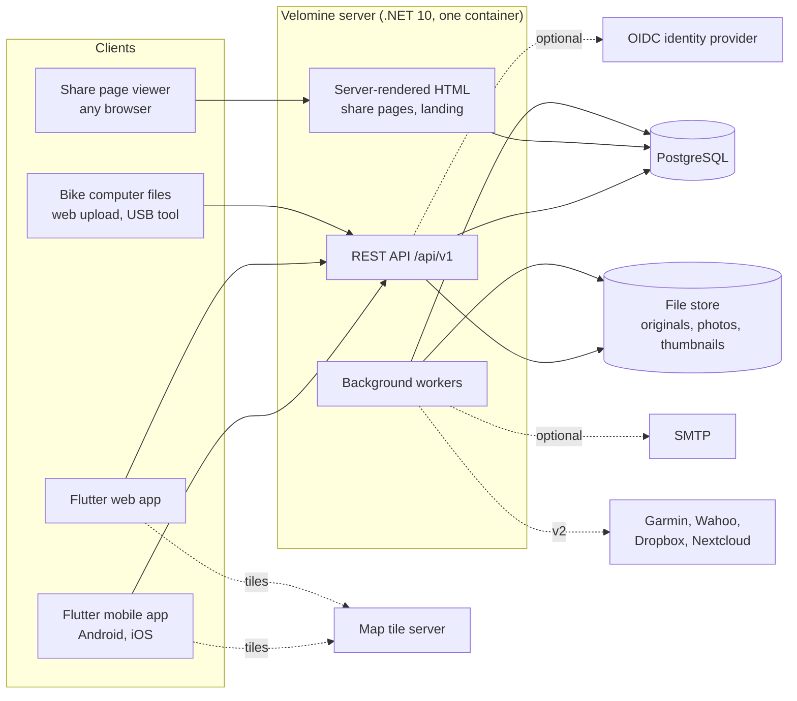
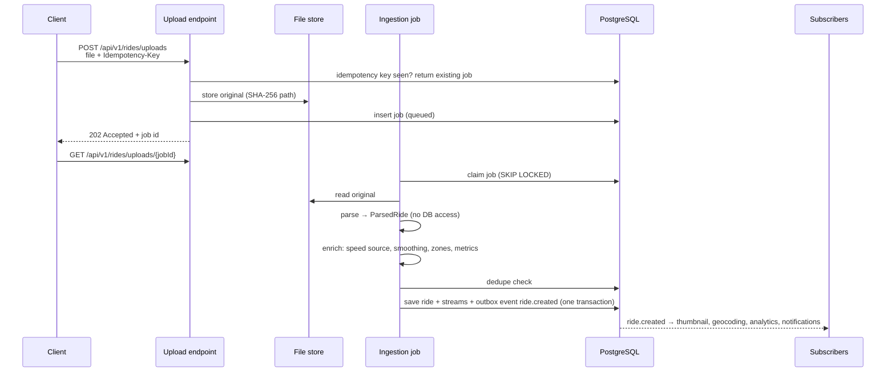
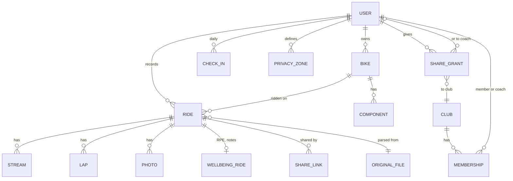
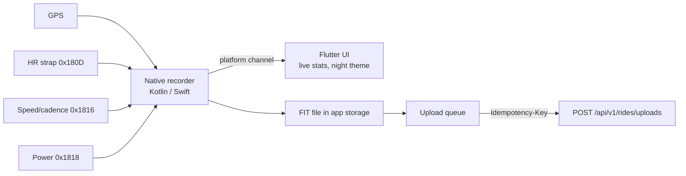

# Velomine architecture

How Velomine is built, end to end: server, apps, share pages and deployment. This document describes the design, not progress. Scope labels (v1, v2) only say which release a part belongs to; the plan itself is in [v1 scope and architecture](design/v1-scope-and-architecture.md).

Rules in [`CLAUDE.md`](../CLAUDE.md) (dependencies, clean-room) override anything here.

## 1. Goals and constraints

- **Self-hosted on one small box.** A club volunteer runs it: one container plus PostgreSQL, configured with environment variables. No Redis, message broker or extra services.
- **Cycling only.** Every model, screen and metric is about bikes and rides.
- **Private by default.** Nothing a member records is visible to anyone else until the member shares it, and every share can be revoked.
- **Members own their data.** Full export (original files + JSON) and complete deletion, from day one.
- **Clean-room.** Endurain's ideas, never its AGPL code.
- **Official libraries first.** Every community library goes through `docs/dependencies/` and owner approval.

## 2. System context



The server is the only source of truth. Every client talks to it; nothing talks to the database directly.

## 3. Deployment

- **One Docker image** for amd64 and arm64, running as a non-root user. It holds the API, the HTML pages, the Flutter web build (served as static files) and the background workers.
- **PostgreSQL** as a second container or an existing server.
- **File store:** one mounted volume for original ride files, photos and thumbnails. Paths are content-addressed (SHA-256), so files are never overwritten.
- **Configuration:** environment variables only, validated on start (`IOptions<T>` with validation). The server refuses to start on invalid config.
- **Migrations** run on start, guarded by a PostgreSQL advisory lock.
- **Backup:** `pg_dump` plus a copy of the file store volume. Restore is documented and tested.

## 4. Server: modular monolith

One ASP.NET Core process, split into feature modules. Each module owns its tables and endpoints.

### Layout

```
src/
  Velomine.Server/          host: Program.cs, config, auth setup, module registration
  Velomine.Modules.<Name>/  one project per module (endpoints, services, entities, migrations)
  Velomine.Shared/          tiny contracts shared by modules (ids, events, export/delete interfaces)
tests/
  Velomine.Modules.<Name>.Tests/
  Velomine.Server.IntegrationTests/
app/                        Flutter app (see section 10)
```

### Module rules

- Request flow is endpoint → service → `DbContext`. No generic repository.
- A module never reads or writes another module's tables. It calls the other module's public C# interface, or reacts to its events.
- Each module has its own `DbContext` and its own PostgreSQL schema (`rides`, `bikes`, …), all in one database.
- Each module implements `IMemberDataExporter` and `IMemberDataEraser`, so export and account deletion cover everything.

### Modules

| Module | Owns | Scope |
|--------|------|-------|
| **Accounts** | Users, roles (admin, member, coach), invites with admin approval, sessions, MFA, OIDC login, scoped API keys (e.g. `rides:upload`), profile (weight) | v1; passkeys v2 |
| **Clubs** | Clubs, memberships, coaches, share grants (data type × audience), revocation, view log | Clubs v1; grants to club/coach v2 |
| **Ingestion** | Uploads, ingestion jobs, idempotency keys, parsers, deduplication | v1; connectors v2 |
| **Rides** | Rides, ride types, streams, laps, HR and power zones, photos | v1 |
| **Bikes** | Bikes, wheel circumference, default bike per ride type, components, wear by km, hours and months | v1; reminders v2 |
| **Wellbeing** | Daily check-in (fatigue, soreness, mood, stress, motivation), RPE and notes per ride | v1; cycle tracking v2 |
| **Analytics** | NP, IF, TSS, TRIMP, FTP (manual), weekly/monthly/yearly totals | v1; power curve, FTP and VO2max estimates, fitness/fatigue/form, readiness v2 |
| **Privacy** | Privacy zones, start/end trimming, per-stream switches; the redaction service | v1 |
| **Sharing** | Share links (token, optional expiry), server-rendered share pages with Open Graph tags | v1 |
| **Notifications** | In-app notifications, email jobs | v1 |
| **Admin** | Server settings, map tile URL, SMTP, OIDC, user approval, job dashboard | v1 |

## 5. Ingestion pipeline

Every ride enters the same way, whatever its source: phone app, web upload, USB tool or a connector.



- **Parsers** turn a file into a canonical `ParsedRide` and know nothing about the database. FIT uses `Garmin.FIT.Sdk`. GPX is read with the BCL XML APIs and supports every common extension (`gpxtpx:hr`, `cad`, `speed`, `atemp`, `PowerInWatts`). TCX likewise. `.gz` is unwrapped first.
- **Speed source:** each ride and speed stream records whether speed came from a wheel sensor or from GPS. Wheel sensor wins when present.
- **Deduplication order:** connector ride id, then SHA-256 of the file plus start time. A likely duplicate is stored hidden and the member is notified.
- **Idempotency:** the `Idempotency-Key` header (the phone uses its local ride id) makes retries safe. Deleting a ride frees its key.
- **Re-parse:** originals are kept forever, so an admin job can re-run the pipeline on all rides when a parser improves.
- **Subscribers** each have a scheduled backfill that finds rides they missed.

## 6. Background work and events

- **Jobs table** in PostgreSQL. Workers are `BackgroundService`s that claim jobs with `SELECT … FOR UPDATE SKIP LOCKED`. Jobs have a type, payload, attempts, next run time and state (queued, running, done, failed, dead).
- **Retries** with exponential backoff; after the last attempt a job goes to *dead* and appears in the admin job dashboard.
- **Events** are written to an outbox table in the same transaction as the change that caused them. A dispatcher turns each event into one job per subscriber, so nothing is lost on restart.
- **Recurring jobs** (backfills, connector polling, maintenance reminders, expired share link cleanup) are rows with a schedule, run by the same workers.

## 7. Data model

Main entities, one PostgreSQL schema per module:



- All instants are `timestamptz` in UTC; the ride also stores its local time zone offset. Units are SI internally.
- Keys are `uuid` (client-generated ids for rides recorded on the phone).
- **Streams** are the largest data. Storage format (one compact binary/array column per stream per ride, or one row per sample) is chosen by measurement before the Rides schema is fixed; the API shape does not depend on it.
- Weight is a single profile field, not a series.

## 8. API contract

- REST under `/api/v1`, ASP.NET Core minimal APIs, OpenAPI document from the built-in generator.
- Errors as `ProblemDetails`. Keyset pagination. Ids as strings in JSON.
- A released API version is never broken: phones update late. Breaking changes go to `/api/v2` while `v1` keeps working.
- Auth: cookie session for the web app, bearer tokens for the mobile app, scoped API keys (`X-API-Key`) for tools such as the USB uploader.
- The Dart client is hand-written at first; a generator from the OpenAPI document can replace it after a dependency evaluation.

## 9. Security and privacy

- **Authorization in the service layer.** Every read checks: owner, or an active grant for that data type and audience. Admins manage the server but do not see members' rides or wellbeing by default.
- **Redaction service** (Privacy module) is the only path for non-owner views. It applies privacy zones (saved places, up to 1 mile), optional start/end trimming and per-stream switches before data leaves the server, for share links and for club and coach views alike. The owner always sees the full track.
- **View log:** every non-owner view of a member's data is recorded and visible to that member.
- **Cycle tracking** (v2) is encrypted at column level with a key from config, never appears in share links, and has its own grant.
- **Consent:** wellbeing and cycle data are health data; explicit consent screens before first use, plus export and deletion.
- **Hardening:** ASP.NET Core rate limiter on login and upload, MFA step-up for API keys and MFA changes, secrets only in env, no telemetry and no third-party calls unless an admin enables them.

## 10. Flutter apps

One Dart codebase builds Android, iOS and the web app.

```
app/
  lib/
    main.dart
    core/        API client, models, auth, design system, charts, maps, i18n (en, it)
    features/    rides/, bikes/, wellbeing/, clubs/, sharing/, admin/, upload/, recording/
  android/       Kotlin: recorder foreground service
  ios/           Swift: recorder with location and Bluetooth background modes
```

- **Design system** in `core/` with two themes from the brand: a day theme (Cloud Dancer, deep teal, iron oxide) for browsing and a night-ride theme (asphalt, Volt) for recording.
- **State:** SDK primitives (`ChangeNotifier`, `ValueNotifier`, `InheritedWidget`). **Navigation:** `go_router`, so web URLs are real.
- **Platform split:** recording, Bluetooth and local storage are mobile-only features behind `kIsWeb` checks; the web app adds drag-and-drop upload and admin screens.

### Mobile recorder



- The native recorder keeps GPS and sensors running with the screen off and survives the app being killed and reopened.
- Speed and distance come from CSC wheel revolutions × the bike's wheel circumference when a speed sensor is paired, otherwise from GPS. Crank revolutions give cadence.
- The ride is saved locally as FIT first; the queue uploads it when there is signal and retries until the server confirms.
- Auto-pause and audio announcements live in the recorder, so they work in the background.
- Bluetooth only, no ANT+.

## 11. Connectors (v2)

Connectors are recurring jobs that fetch new FIT files and push them into the same ingestion pipeline, with the provider's ride id for deduplication: Garmin (official personal key), Wahoo cloud, watched Dropbox or Nextcloud folder. Credentials are stored encrypted per member and can be removed at any time.

## 12. Dependencies that need an evaluation

These are expected needs. None may be added before its evaluation in `docs/dependencies/` is approved.

| Need | Candidate | Why it is not official |
|------|-----------|------------------------|
| EF Core provider for PostgreSQL | `Npgsql.EntityFrameworkCore.PostgreSQL` | Published by the Npgsql project, not Microsoft |
| Bluetooth LE in Flutter | `universal_ble` or similar | Flutter has no official BLE plugin |
| Map widget | `flutter_map` | Community package |
| GPS and background location | `geolocator`, or native code only | Community package; the native recorder may make it unnecessary |
| Charts | a chart package, or custom painting | No official chart package |
| Local storage on mobile | `sqflite`, or plain files | Community package |
| OpenAPI Dart generator | to be chosen | Only if hand-written client becomes a burden |

## 13. Decisions to record as ADRs

Write each as `docs/adr/NNNN-title.md` once agreed:

1. Modular monolith with one schema per module.
2. PostgreSQL jobs table and outbox instead of a broker or Redis.
3. Flutter web for the logged-in web app; server-rendered HTML for share and landing pages.
4. Original files kept forever; FIT as the format recorded on the phone.
5. Stream storage format (after measurement).
6. Redaction service as the single path for every non-owner view.
